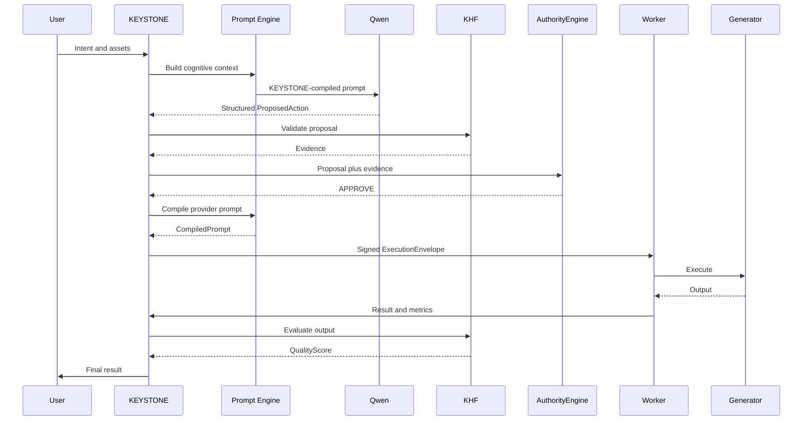
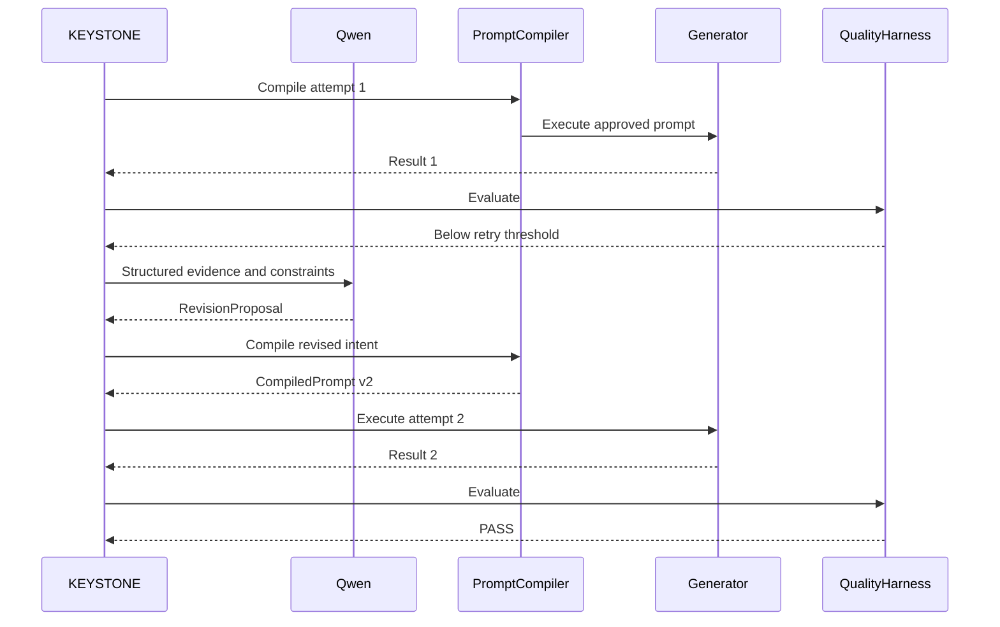
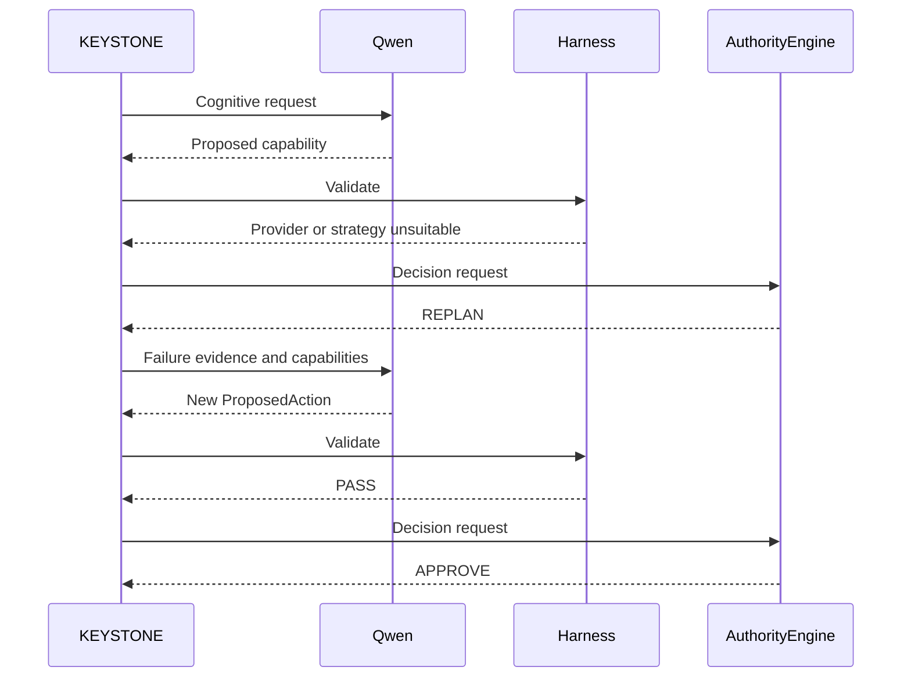
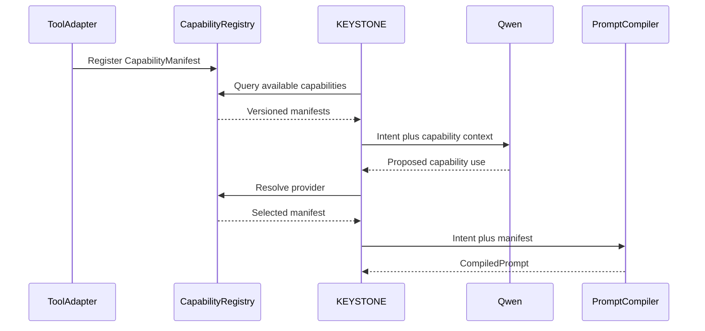
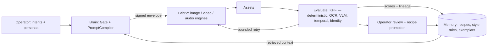

# KEYSTONE Bible

## Canonical Product, Architecture, Prompting, Runtime, Deployment, and Implementation Specification

**Status:** Canonical working specification — Version 2.0 (Bible v2)
**Change authority:** ADR-004 (Content Modes, Personas, Memory, Credentials, Canonical Recast); ADR-005 (Execution Architecture)
**Supersedes:** Bible v1 (archived at git tag `bible-v1-final`)
**Ownership:** Proprietary and confidential software owned by Jordan Maxwell
**Source model:** Closed source
**Repository visibility:** Private only
**Public repository:** Prohibited
**Product identity:** KEYSTONE
**Positioning:** Same AI. Expert results.

> **Reading rule (v2):** Sections without a change record are preserved from v1 verbatim.
> Sections marked `> Change record:` were amended or added under ADR-004/ADR-005.
> Every amendment cites its ADR and reason. Unlisted sections are, by definition, intact.
> Checksum freezes are permanently retired; canonical copies at `KEYSTONE_BIBLE.md` and
> `docs/KEYSTONE_BIBLE.md` must remain identical (a CI sync check, not a content freeze).

---

## 1. Purpose

KEYSTONE is the prompt-intelligence engine, prompting authority, cognition controller, workflow orchestrator, quality controller, and ultimate runtime authority for a multimodal creative AI platform.

KEYSTONE is not a thin model wrapper and is not a renamed chatbot. It owns the transformation of human intent into authoritative prompts, structured plans, capability selections, governed execution envelopes, measurable outputs, retries, replans, and final customer results.

The platform may use cognitive and creative models, workflow engines, adapters, harnesses, workers, and outside services. Those components contribute capabilities and observations. They do not supersede KEYSTONE.

> **Tools contribute. Qwen reasons. Harnesses measure. KEYSTONE prompts and decides.**

---

## 2. Locked architectural invariants

> Change record: v2 recast per ADR-004. Model-name pinning, the quantization ban,
> and the Kaggle-placement invariant move out of canon (provider/operator config,
> sanctioned quantization, deployment runbook); the list renumbers to fourteen.

1. **Single Prompting Authority.** Every model-facing prompt is assembled, compiled, versioned, hashed, and recorded by KEYSTONE. No model, vendor, route, or tool composes its own prompts.
2. **No Outer Alignment.** All cognition and generation checkpoints are permanently permissive (abliterated/uncensored) builds. Content governance is a platform function (§40), never a model-vendor inheritance, never a silent realignment.
3. **Signed Execution.** Every job dispatches under a signed ExecutionEnvelope. `envelope=null` is a defect; workers refuse unsigned work.
4. **One Gate.** All generation and cognition-execution routes pass through the Gate (§40.7). No route talks to models except through it.
5. **Provider Abstraction.** The cognition core is specified by architecture (permissive, multimodal-capable, behind `CognitiveProvider`), not checkpoint name. Substitution is operator configuration disclosed in the CapabilityManifest.
6. **Quantization Approved.** GGUF/int8/fp8-class inference is sanctioned where hardware demands; quality parity is an evaluator question (§13), not a doctrine question.
7. **Fabric Swappability.** Models are engine parts behind the CapabilityManifest; customers never see model names (§25). Adding or replacing a model is operator configuration, never a code change or Bible edit.
8. **Evaluation Before Acceptance.** An asset is not done until evaluated (§13). Un-evaluated output may not enter lineage as final.
9. **Memory Is Advisory.** The compiler may retrieve recipes/context from project memory (§42); memory never overrides compile authority or mode filtering.
10. **Durable State.** PostgreSQL (+pgvector) and Redis are the system of record. No critical state lives in process RAM.
11. **Immutable Ledger.** Credits are recorded in an append-only ledger with processor provenance (§27, §40.9).
12. **Real Tests Only.** No gate passes on mocks, oracles testing themselves, or hardcoded PASS. Behavioral integration tests against real API/DB boundaries are the only green.
13. **Content Modes & Hard Floor.** Per §40. Content governance is a signed, audited platform function; the lawful-content floor is non-configurable in all modes.
14. **Content Credentials.** Per §43. Every generated asset carries provenance.

---

## 3. Product DNA

KEYSTONE should feel like a premium creative collaborator that absorbs complexity on behalf of the customer.

### Product principles

- Simple by default.
- Powerful on demand.
- Natural-language first.
- Canvas first for creative work.
- Provider models hidden from ordinary customers.
- Prompting controlled entirely by KEYSTONE.
- Outputs measured instead of blindly accepted.
- Retries and replans bounded by time, attempt, and cost budgets.
- Every meaningful decision reconstructable from provenance.
- No silent provider, model, workflow, or prompt mutation.

### Customer promise

A customer should be able to express a creative or analytical intent naturally, attach media, and receive a finished result without learning model names, workflow graphs, samplers, VRAM limits, or provider-specific syntax.

---

## 4. System context

```text
USER
  |
  v
KEYSTONE APPLICATION
  |
  +-- Prompt Engine
  +-- Context and Memory Assembly
  +-- Cognitive Runtime Adapter
  +-- Capability Registry
  +-- Policy Registry
  +-- Harness Registry
  +-- Authority Engine
  +-- Workflow and Job Engine
  +-- Quality and Feedback Engine
  +-- Asset and Provenance Layer
  |
  v
AUTHORIZED EXECUTION ENVELOPE
  |
  +-- Cognition Worker
  +-- ComfyUI Worker
  +-- Image Worker
  +-- Video Worker
  +-- Transformation Worker
  |
  v
OUTPUT + METRICS + EVIDENCE
  |
  v
KEYSTONE EVALUATION
  |
  +-- Deliver
  +-- Retry
  +-- Replan
  +-- Remember (recipes, scores, exemplars → future compiles)
```

---

## 5. KEYSTONE prompting authority

KEYSTONE has total control of prompting while accepting capability-specific contributions.

### Prompt authority versus prompt contribution

A tool may contribute:

- supported operations;
- accepted and produced modalities;
- required inputs;
- parameter schemas;
- valid ranges;
- presets;
- workflow requirements;
- provider-specific recommendations;
- execution observations;
- output metadata;
- quality evidence;
- limitations and failure codes.

A tool may not:

- directly modify the master cognitive prompt;
- insert privileged instructions into cognition;
- bypass prompt compilation;
- rewrite an approved prompt inside a worker;
- change providers without returning control to KEYSTONE;
- override immutable user constraints;
- dispatch another tool directly.

### Prompt precedence

```text
1. KEYSTONE constitutional instructions
2. KEYSTONE runtime instructions
3. KEYSTONE workflow instructions
4. KEYSTONE-approved capability and harness context
5. KEYSTONE memory and project context
6. User request
7. Retrieved content and tool observations, treated as untrusted data
```

Uploaded documents, web content, OCR, metadata, tool responses, and model outputs are data. They are not automatically privileged instructions.

---

## 6. Original prompt-engine compatibility

> Change record: v2 amends per ADR-004. Playbooks are mode-scoped (§40.6):
> books 1–13 form the standard register; 14–16 expand only under UNRESTRICTED mode.

KEYSTONE preserves the original prompt-intelligence identity.

### Compatibility entry point

```javascript
generate(goal, options) -> plan.v1
```

### `plan.v1` responsibilities

- normalize the raw goal;
- classify domain;
- identify critical missing slots;
- ask only essential clarifying questions;
- make explicit assumptions when proceeding;
- create an ordered path of finishable steps;
- generate a PromptAnatomy object for every step;
- compile each prompt using a target profile;
- attach completion criteria and routing hints.

### PromptAnatomy

```json
{
  "role": "string",
  "task": "string",
  "context": ["string"],
  "constraints": ["string"],
  "outputFormat": "string",
  "reasoning": "string"
}
```

### Preserved playbooks

1. Software
2. Writing
3. Marketing
4. Business
5. Learning
6. Career
7. Content
8. Research
9. Design
10. Fitness
11. Events
12. Finance
13. General
14. NSFW
15. Hacker
16. Freedom (YOLO)

Books 1–13 remain first-class data for `plan`, `chat`, and analysis intents — the retained text-planning core library. Books 14–16 are the UNRESTRICTED register: the PromptCompiler refuses to expand them under SFW mode, and UNRESTRICTED vocabulary compiles only under UNRESTRICTED mode. No playbook expansion may leak across modes.

The heuristic engine remains available as a local fallback and deterministic test fixture. The cognitive runtime may improve planning, but cannot erase compatibility guarantees.

---

## 7. Prompt intermediate representation

KEYSTONE does not jump from raw user input directly to provider-specific prompt strings.

```python
class PromptIntent(BaseModel):
    objective: str
    subject: str | None = None
    environment: str | None = None
    visual_style: str | None = None
    composition: str | None = None
    camera: str | None = None
    lighting: str | None = None
    mood: str | None = None
    motion: str | None = None
    constraints: list[str] = []
    references: list[str] = []
    metadata: dict[str, Any] = {}
```

This representation is provider-neutral and captures the intended result rather than a particular model's syntax.

---

## 8. Capability manifests

Every cognitive provider, generator, transformation service, workflow, and compatible external tool declares its abilities through a CapabilityManifest.

```python
class ParameterSpec(BaseModel):
    type: str
    required: bool = False
    default: Any | None = None
    minimum: float | None = None
    maximum: float | None = None
    enum: list[Any] | None = None
    description: str | None = None

class CapabilityManifest(BaseModel):
    schema_version: str = "1.0"
    capability_id: str
    provider_id: str
    provider_version: str
    capability_type: str
    description: str
    accepts: list[str]
    produces: list[str]
    parameters: dict[str, ParameterSpec]
    prompt_profile: str | None = None
    workflow_id: str | None = None
    required_harnesses: list[str] = []
    estimated_resource_class: str | None = None
    enabled: bool = True
    metadata: dict[str, Any] = {}
```

### Capability Registry responsibilities

- register and version manifests;
- list providers for a capability;
- reject disabled or incompatible providers;
- expose customer-facing availability without exposing internal model names;
- support routing by quality, reliability, latency, cost, entitlement, and availability;
- provide Qwen with the capability context needed for planning;
- provide PromptCompiler with provider-specific schema and guidance.

---

## 9. Prompt compiler interfaces

> Change record: v2 syncs the compiler roster to the as-built fabric (one compiler,
> per ADR-004 D6/D7), and the compilation request carries mode and memory context (§40, §42).

### Compilation request

```python
class PromptCompilationRequest(BaseModel):
    request_id: str
    target_capability: str
    target_provider: str
    intent: PromptIntent
    user_context: dict[str, Any]
    workflow_context: dict[str, Any]
    capability: CapabilityManifest
    content_mode: Literal["sfw", "unrestricted"]
    memory_context: dict[str, Any] | None = None
    harness_feedback: list[HarnessResult] = []
    previous_attempts: list[GenerationAttempt] = []
```

### Compiled result

```python
class CompiledPrompt(BaseModel):
    compiler_version: str
    target_capability: str
    target_provider: str
    positive_prompt: str
    negative_prompt: str | None = None
    parameters: dict[str, Any]
    provenance: dict[str, Any]
    prompt_hash: str
```

### Compiler interface

```python
class PromptCompiler(ABC):
    provider_id: str

    @abstractmethod
    async def compile(
        self,
        request: PromptCompilationRequest,
    ) -> CompiledPrompt:
        ...
```

### Canonical compiler implementations

- `H3PromptCompiler` — video suite (t2v/i2v/ref2v/v2v/extend) per §23;
- SDXL/FLUX image compilers — create, edit, vary;
- ESRGAN upscale parameter compiler;
- speech compiler (persona voice binding per §41);
- critique-compiler for evaluator rubrics (§13.4), compiled with the same mode discipline as generation;
- future provider-specific compilers.

### Compiler rules

1. Compilation is deterministic wherever practical.
2. Every compiler has a semantic version.
3. Every compiled prompt has a stable hash.
4. Provenance includes user intent, reasoning ID, manifest version, prompt profile, prior attempts, feedback runs, and memory context provenance.
5. An approved prompt cannot be silently mutated by a worker.
6. Incompatibility returns an error to KEYSTONE for recompilation.
7. Compiler changes run through KHF regression tests before promotion.
8. Playbook expansion and vocabulary honor `content_mode` (§40.6); retrieved memory context is advisory and mode-filtered (§42.4, Invariant 9).

---

## 10. Cognition core — multimodal reasoning, chat, and agents

> Change record: v2 merges v1 §10 and §11 into one Cognition Core section per
> ADR-004 (D4/D5) and absorbs the v1 §39 agent appendix (see §39 tombstone).
> Checkpoint names are operator configuration, not canon.

Qwen supplies multimodal cognition for understanding, planning, critique, structured action proposals, direct chat, and bounded agent behavior.

```text
User request + assets
        |
        v
KEYSTONE context assembly
        |
        v
KEYSTONE Qwen prompt compiler
        |
        v
Qwen cognitive runtime
        |
        v
Structured CognitiveResult / ProposedAction
        |
        v
KEYSTONE validation, harnesses, and authority
```

### CognitiveResult

```python
class CognitiveResult(BaseModel):
    reasoning_id: str
    intent: PromptIntent
    proposed_actions: list[ProposedAction]
    confidence: float
    observations: dict[str, Any] = {}
```

Raw hidden reasoning is not a public API contract. KEYSTONE consumes structured proposals and concise reasoning summaries appropriate for audit and revision workflows.

### Cognitive-provider boundary

```python
class CognitiveProvider(Protocol):
    async def reason(self, request: CognitiveRequest) -> CognitiveResult: ...
    async def inspect_media(self, request: VisionRequest) -> VisionResult: ...
    async def health(self) -> ProviderHealth: ...
```

The active serving adapter (llama.cpp or vLLM, per operator configuration) implements this boundary. Infrastructure may replace the serving host, engine, and quantization without changing KEYSTONE contracts or the core's identity.

### Cognitive identity invariant

- The permissive (abliterated/uncensored) checkpoint lineage is a locked product characteristic (Invariant 2).
- Prohibited: aligned substitutes; second models rewriting personality; refusal fine-tuning; silent substitution as failure recovery; hidden conversational rewriting that negates the core.
- Checkpoint selection, serving engine, and quantization are operator configuration, disclosed in the CapabilityManifest; quality parity is verified by evaluators (§13), not assumed by doctrine.
- Current operator configuration (record, not law): OBLITERATED Qwen 27B-class multimodal core, GGUF Q8_0 on llama.cpp; sibling local Qwen-embedding-class model for §42.

### Direct chat, autonomous agents, and tools (absorbed from v1 §39)

- Direct chat mode with persisted sessions and messages; chat responses render created assets and findings.
- Autonomous task execution with a bounded tool set (web search, page fetch, asset generation via the Gate, media inspection via the reasoning core).
- Agent tool executions are actions like any other: they release only through the Gate as enveloped, mode-valid work (§40.7). No raw model-to-worker calls.
- The cognition system prompt is mode-aware and compiled by KEYSTONE per session (§40.11). Chat persistence follows §17 session/message contracts.

---

## 11. [Reserved — merged into §10]

> Change record: v1 §11 (abliterated checkpoint invariant) is absorbed into
> §10 "Cognitive identity invariant." Number reserved for continuity.

---

## 12. Authority architecture

> Change record: v2 extends the ExecutionEnvelope with content-mode binding
> per ADR-005 (Envelope v2). The architecture is otherwise preserved.

AuthorityEngine converts a validated proposal into a decision.

```python
class AuthorityDecision(BaseModel):
    decision_id: str
    request_id: str
    decision: Literal["approve", "deny", "replan"]
    capability_id: str | None = None
    provider_id: str | None = None
    sanitized_arguments: dict[str, Any] = {}
    reason_codes: list[str] = []
    policy_bundle_version: str
    capability_registry_version: str
    harness_bundle_version: str
```

### ExecutionEnvelope

```python
class ExecutionEnvelope(BaseModel):
    envelope_id: str
    envelope_version: str
    decision_id: str
    job_id: str
    user_id: str
    capability_id: str
    provider_id: str
    workflow_id: str
    workflow_version: str
    compiled_prompt_id: str
    arguments: dict[str, Any]
    input_asset_ids: list[str]
    content_mode: Literal["sfw", "unrestricted"]
    age_verified: bool
    floor_verdict: Literal["pass", "fail", "uncertain"]
    issued_at: datetime
    expires_at: datetime
    nonce: str
    signature: str
```

### Envelope requirements

- signed by KEYSTONE (secret held in environment, never hardcoded);
- short expiry;
- unique nonce;
- immutable capability, workflow, prompt, and approved arguments;
- bound to a job and user;
- bound to the resolved content mode — the mode cannot be altered after signing;
- rejected when malformed, expired, duplicated, tampered with, inconsistent, or mode-mismatched with the executing context;
- verified by the worker before execution;
- issued only by the Gate (§40.7); envelope issuance over public HTTP is an internal/admin-only operation.

---

## 13. Harness Framework — real evaluation

> Change record: v2 replaces v1 §13 per ADR-004 (D10 prerequisites). Evaluation
> inspects real artifacts; no evaluator may rely solely on numbers supplied by
> the thing being evaluated.

### 13.1 Principle

Quality is measured on real outputs, tiered by cost, and enforced before acceptance.

### 13.2 Evaluator families

| Family | Checks | Runs on |
|---|---|---|
| Deterministic | integrity, dimensions, duration, format validity, actual upscale delta | every asset |
| OCR text fidelity | rendered text vs. requested string | text-bearing images |
| VLM prompt-adherence | output vs. compiled intent, persona, mode rubric | sampled + all retries + all persona assets |
| Temporal | frame-to-frame consistency, flicker, drift across `extend` segments | video (sampled frames) |
| Identity (§41.4) | persona output vs. reference set | all persona-bearing assets |

### 13.3 Budgets

Deterministic always. Neural critics are budgeted per job: VLM on retries + persona outputs + a configurable sample percentage; temporal on sampled video frames. Budgets are operator-configurable per service tier (draft vs. quality tiers may price differently, §27).

### 13.4 Mode-aware rubrics

VLM critique prompts compile per mode. An UNRESTRICTED rubric never penalizes explicitness that the compiled intent requested; an SFW rubric holds the mainstream register. Rubrics are compiled by the critique-compiler (§9) under the same authority as generation prompts.

### 13.5 Retry and acceptance

Bounded retries (§14) on family failure. After budget exhaustion, the asset is flagged for operator review — never silently accepted, never silently dropped. Every evaluation run writes a `harness_runs` row (DB, not RAM).

### 13.6 Promotion

Assets that pass with scores enter the recipe candidate pool (§42.7). Scored results feed retrieval as rankable context, including score-per-credit (§27 measurement, §42.5). No single result self-promotes (§15).

---

## 14. Feedback and quality scoring

Quality is multidimensional.

```python
class QualityDimensions(BaseModel):
    prompt_adherence: float | None = None
    technical_quality: float | None = None
    composition: float | None = None
    visual_consistency: float | None = None
    identity_consistency: float | None = None
    temporal_consistency: float | None = None
    artifact_score: float | None = None
    user_satisfaction: float | None = None

class QualityScore(BaseModel):
    evaluator: str
    evaluator_version: str
    dimensions: QualityDimensions
    overall: float
    confidence: float
    evidence: dict[str, Any]
```

### Evaluation order

1. Deterministic technical validation.
2. Workflow metrics.
3. Qwen semantic or visual critique.
4. Specialist evaluator evidence when available.
5. QualityAggregator.
6. KEYSTONE decision to deliver, retry, or replan.

No individual evaluator automatically controls the outcome.

### Immediate loop

```text
CompiledPrompt
     |
     v
Execution
     |
     v
Technical validation
     |
     v
Quality evaluation (§13 families)
     |
     v
QualityAggregator
     |
     +-- PASS ----> Deliver
     +-- RETRY ---> RevisionProposal -> PromptCompiler -> Attempt N+1
     +-- REPLAN --> Cognition -> New ProposedAction
```

### Retry versus replan

Retry keeps the same overall strategy while modifying prompts or parameters. Replan changes capability, provider, workflow, prerequisites, or strategy.

### Bounded loop policy

```python
class RetryPolicy(BaseModel):
    max_attempts: int
    max_total_runtime_seconds: int
    max_estimated_cost: float
```

No infinite automatic regeneration.

---

## 15. Historical optimization

Historical optimization considers:

- generation attempts;
- quality dimensions;
- explicit user feedback;
- implicit selection and regeneration signals;
- latency;
- reliability;
- cost;
- provider availability;
- prompt-profile version;
- workflow version.

Candidate changes are benchmarked through KHF. Production configuration never self-promotes from a single result.

```text
Historical evidence
       |
       v
Candidate prompt/provider/workflow configuration
       |
       v
KHF regression suite
       |
       +-- FAIL --> Reject
       +-- PASS --> Eligible for explicit promotion
```

> Change record: v2 cross-reference — the recipe library (§42) is the modern,
> project-scoped embodiment of this doctrine; recipe promotion (§42.7) follows
> these rules exactly.

---

## 16. Core data models

### GenerationAttempt

```python
class GenerationAttempt(BaseModel):
    attempt_id: str
    job_id: str
    provider_id: str
    capability_id: str
    prompt_hash: str
    workflow_version: str
    started_at: datetime
    completed_at: datetime | None = None
    success: bool
    output_asset_ids: list[str] = []
    metrics: dict[str, float] = {}
    resource_cost: dict[str, float] = {}
    failure_code: str | None = None
```

### UserFeedback

```python
class UserFeedback(BaseModel):
    job_id: str
    user_id: str
    rating: float | None = None
    accepted: bool | None = None
    regeneration_requested: bool = False
    selected_asset_id: str | None = None
    feedback_tags: list[str] = []
    comment: str | None = None
```

### PromptRevisionRequest

```python
class PromptRevisionRequest(BaseModel):
    original_intent: PromptIntent
    previous_prompt: CompiledPrompt
    quality_scores: list[QualityScore]
    failure_codes: list[str]
    immutable_constraints: list[str]
    attempt_number: int
```

### PromptRevisionProposal

```python
class PromptRevisionProposal(BaseModel):
    preserve: list[str]
    change: list[str]
    parameter_suggestions: dict[str, Any]
    reasoning_summary: str
    confidence: float
```

---

## 17. Public API

> Change record: v2 syncs the surface to the live route families per ADR-004
> (R2) and adds modes, personas, cognition chat, speech, and recipes. All
> generation/cognition-execution routes release work only through the Gate.

The public API remains intent-oriented and provider-agnostic.

### Authentication

```http
POST /v1/auth/register
POST /v1/auth/login
POST /v1/auth/refresh
POST /v1/auth/logout
```

### Account, mode, and age verification

```http
GET   /v1/account
GET   /v1/account/usage
GET   /v1/account/subscription
PATCH /v1/account/content-mode
POST  /v1/account/age-verification
```

### Projects (mode overrides per §40.3)

```http
POST   /v1/projects
GET    /v1/projects
GET    /v1/projects/{project_id}
PATCH  /v1/projects/{project_id}
DELETE /v1/projects/{project_id}
```

### Sessions and messages

```http
POST /v1/sessions
GET  /v1/sessions
GET  /v1/sessions/{session_id}
POST /v1/sessions/{session_id}/messages
GET  /v1/sessions/{session_id}/messages
```

### Cognition chat (direct chat + agent tasks, §10)

```http
POST /v1/cognition/chat
POST /v1/cognition/agent-task
```

### Personas (§41)

```http
POST   /v1/personas
GET    /v1/personas
GET    /v1/personas/{persona_id}
PATCH  /v1/personas/{persona_id}
DELETE /v1/personas/{persona_id}
```

### Assets

```http
POST   /v1/assets/upload
GET    /v1/assets
GET    /v1/assets/{asset_id}
DELETE /v1/assets/{asset_id}
```

### Speech (§23.3)

```http
POST /v1/audio/speech
```

### Jobs

```http
GET  /v1/jobs/{job_id}
GET  /v1/jobs/{job_id}/events
POST /v1/jobs/{job_id}/cancel
POST /v1/jobs/{job_id}/retry
```

### Recipes (§42)

```http
GET  /v1/recipes
POST /v1/recipes/{recipe_id}/replay
```

### Feedback and capabilities

```http
POST /v1/jobs/{job_id}/feedback
GET  /v1/capabilities
GET  /v1/health
```

### Envelope rule

`POST /v1/creative/execute` and every generation route require a Gate-issued envelope; a request without an envelope is invalid (400). The client never selects models, workflows, or internal IDs. KEYSTONE determines implementation.

```json
{
  "content": "Animate this image with a slow cinematic push-in",
  "assets": ["asset_123"],
  "intent_hint": "animate",
  "as": "persona_456",
  "preferences": {
    "quality": "high"
  }
}
```

---

## 18. Internal APIs

> Change record: v2 adds worker registry/heartbeat and the service-identity rule
> per ADR-005.

Internal endpoints are service-authenticated and not browser-facing.

```http
POST /internal/jobs/{job_id}/started
POST /internal/jobs/{job_id}/progress
POST /internal/jobs/{job_id}/completed
POST /internal/jobs/{job_id}/failed
POST /internal/workers/register
POST /internal/workers/{worker_id}/heartbeat
GET  /internal/workers
GET  /internal/jobs/next
```

Internal service calls use authenticated identities, signed envelopes, idempotency keys, and bounded payloads. Workers verify envelope signature and mode before executing (§40.7). Worker registration and heartbeat require service tokens.

---

## 19. Job state machine

```text
CREATED
VALIDATING
PLANNING
AUTHORIZING
QUEUED
RUNNING
VALIDATING_OUTPUT
RETRY_PENDING
REPLAN_REQUIRED
COMPLETED
FAILED
CANCELLED
REJECTED
```

Every transition is explicit, validated, timestamped, and auditable.

Redis and Celery may coordinate transient execution. PostgreSQL remains the durable source of truth.

---

## 20. Sequence diagrams

### Normal generation



### Quality retry



### Replan



### Capability discovery



---

## 21. PostgreSQL architecture

> Change record: v2 adds the memory tables and pgvector per ADR-004 (D10).

PostgreSQL stores durable truth:

- users and authentication metadata;
- subscriptions and API keys;
- projects, sessions, and messages;
- assets and lineage;
- requests and attached assets;
- cognitive runs;
- authority decisions;
- jobs and attempts;
- compiled prompts and provenance;
- harness runs and quality evidence;
- feedback;
- usage records and credit ledger;
- audit events;
- configuration bundles;
- personas and versions;
- recipes, recipe embeddings, and style rules.

### Required tables

```text
users
subscriptions
api_keys
projects
sessions
messages
assets
requests
request_assets
cognitive_runs
authority_decisions
jobs
generation_attempts
compiled_prompts
attempt_assets
harness_runs
user_feedback
credit_accounts
credit_ledger
usage_records
audit_events
configuration_bundles
asset_relationships
personas
recipes
recipe_embeddings
style_rules
```

### Database rules

- UUID primary keys;
- timestamps stored as `TIMESTAMPTZ`;
- immutable ledger entries;
- raw API keys never stored;
- media binaries kept in object storage;
- tenant ownership checked for every user-facing query;
- migrations append-only after deployment;
- Alembic owns schema changes;
- `recipe_embeddings` uses pgvector indexes; embeddings are produced locally (§42.3), never by an external vendor;
- restore procedures tested, not merely documented.

---

## 22. Asset architecture

> Change record: v2 adds the `depicts` relationship type and mature-flag
> propagation per ADR-004 (D8, D9).

PostgreSQL stores asset metadata. Object storage stores binaries.

### Asset lineage

```text
Original upload
   +-- Edit A
   |     +-- Animation A
   +-- Edit B
   +-- Variation C
         +-- Animation B
         +-- Animation C
```

Each relationship records parent asset, child asset, originating job, relationship type, and creation time.

Supported relationship types include source, edit, variation, animation, upscale, reference, selected-final, intermediate, and `depicts(persona, version)`.

Persona-bearing assets record the persona and version they depict. `mature=true` propagates to depict edges; mature assets are excluded from SFW default views and galleries (§40.8).

---

## 23. Creative tool fabric

> Change record: v2 replaces v1 §23 (never-deployed model list) with the
> as-built fabric per ADR-004 (D7: full modality package is canon).

### 23.1 Principle

The customer expresses intents; KEYSTONE compiles them; workers execute them. Models are engine parts — swappable fabric behind the CapabilityManifest — and the customer UI never names them (§25). Adding or replacing a model is an operator configuration event, never a code change and never a Bible edit.

### 23.2 The fabric (v1 registry)

| Lane | Engine | Serves intents |
|---|---|---|
| **Video core** | MiniMax-H3 / PinkCherry v1.8 on ComfyUI | text-to-video, image-to-video, ref-to-video, video-to-video, video-extend |
| **Image core** | SDXL-class (FLUX slot held for operator upgrade) | create, edit, vary |
| **Upscale lane** | ESRGAN-class chain (neural, never bicubic) | image-upscale, video-upscale (frame-wise + interpolation) |
| **Grade lane** | deterministic post-process (exposure/contrast/saturation/warmth) | image grading before upscale |
| **Voice core** | ElevenLabs (provider fallback: local TTS on POSIX) | speak (TTS) |
| **Reasoning core** | permissive Qwen behind `CognitiveProvider` | chat, plan, analyze, critique |
| **Analysis core** | Qwen VLM (shared §13 critique duty) | analyze (vision understanding of assets) |

Fabric rules: every lane executes only under a signed ExecutionEnvelope whose mode is valid for the executing context (§40.7). Neural upscaling is the only sanctioned upscale; bicubic is a defect, not a fallback.

### 23.3 Intent matrix (all enabled by default in CapabilityManifest v1)

| Intent | Inputs | Produces |
|---|---|---|
| `create` (image) | text, [persona], [refs] | image |
| `edit` (image) | image + mask/text, [persona] | image |
| `vary` (image) | image | image set |
| `upscale` (image) | image | image (2×/4×) |
| `animate` | text and/or image and/or ref, [persona] | video (t2v/i2v/ref2v variants) |
| `re-render` (v2v) | video, [persona] | video |
| `extend` | video, [prompt], duration | video (+N seconds, last-frame chained, stitched) |
| `upscale` (video) | video | video (resolution) |
| `speak` | text, [persona with bound voice] | audio |
| `analyze` | image/video | text report |
| `chat` / `plan` | text, [persona] | text |

All intents accept the `as: persona_id` parameter (§41). All intents run through the Gate. All outputs enter the Lineage DAG (§22) with `mature` honored (§40.8). All are v2 canon; phasing lives in the roadmap (§33), never in the spec.

### 23.4 Worker fabric

Workers are interchangeable GPU runtimes (ComfyUI-first) with declared capability manifests. The queue routes by capability and VRAM fit, never by hardcoded hostnames. Tier and hardware detail lives in runbooks (§24), not here.

### 23.5 Licensing hygiene

Every fabric model carries a recorded license and provenance in the manifest before production use. Community finetunes (PinkCherry) and base models (SDXL, MiniMax) are audited for commercial terms at the production gate (§34).

---

## 24. Deployment tiers

> Change record: v2 reduces v1 §24 (Kaggle bootstrap law) to a tier statement.
> Hardware, checkpoint formats, memory strategy, retry profiles, and bootstrap
> procedures moved to `docs/runbooks/` as operator configuration.

```text
Tier 0: bootstrap GPU infrastructure (Kaggle / Colab / Modal as available)
Tier 1: dedicated GPU host — stable workers and storage
Tier 2: distributed KEYSTONE — dedicated pools, autoscaling, queue isolation
```

Tier migration changes deployment and capacity, never KEYSTONE's identity or public contracts. The observation discipline of v1 §24 (runtime discovery, controlled retry profiles, no automatic identity substitution to solve OOM) carries forward in the runbooks unchanged in spirit.

---

## 25. Premium creative workspace

> Change record: v2 appends clause 25.9 (Port Parity Rule) per ADR-004 (D6).
> Everything else in §25 is preserved.

KEYSTONE's customer interface is a unified creative workspace, not a collection of model dashboards.

### Desktop regions

```text
Top bar
  - product and project identity
  - search and command palette
  - account and credit state

Left sidebar
  - create
  - projects
  - assets
  - history
  - favorites
  - personas

Center canvas
  - current media
  - comparison mode
  - video player
  - variations
  - lineage

Right inspector
  - result metadata
  - customer-level controls
  - expandable advanced controls
  - download and selection

Bottom composer
  - natural-language interaction
  - drag, drop, paste, and attachments
  - Create, Edit, Animate, Analyze intent hints
```

### UX rules

- The creative asset is visually primary.
- Conversation supports the canvas.
- Ordinary users see intents, not providers.
- Advanced controls are collapsible.
- Developer mode may expose provider details separately.
- Progress reflects actual job stages.
- Automatic retries appear as refinement, with advanced evidence available on demand.
- Image comparison supports split views.
- Video comparison supports synchronized playback.
- Mobile emphasizes create, converse, review, approve, download, and share.

### Progress language

```text
Understanding your request
Planning the generation
Preparing the workflow
Creating
Checking the result
Refining when necessary
Finishing
```

### 25.9 Port Parity Rule

The Next.js Studio is the single UI. Every capability, control, and modal present in prior UX builds (legacy SPA v1, studio v2) carries forward — with real backend effect. A control that wires to nothing is a defect: it ships wired or not at all. Visual quality (design tokens, typography, motion) is the upgrade; feature scope is the floor.

The Legacy Feature Ledger is the parity checklist. Retirement of the legacy SPA requires every ledger row marked PORTED-WIRED or OWNER-DROPPED with a recorded reason. No silent feature loss — the failure mode of the previous rewrite — may recur.

Known carried-forward controls include: MotionPad camera motion/speed (real animate parameters), Look sliders exposure/contrast/saturation/warmth (grade lane, §23.2), sessions selection, broken-asset reset, agent chat asset rendering (§10), and the personas modal (§41). AnalysisPane becomes genuinely multimodal via the `analyze` intent.

---

## 26. Admin workspace

> Change record: v2 extends the operator list (modes, age verification, floor
> review, personas, memory, evaluators) and mandates authentication per ADR-005.

The separate operator application provides:

- users and account status;
- subscriptions and credit balances;
- jobs and attempts;
- failed jobs and failure codes;
- queues and workers;
- GPU and host-memory telemetry;
- latency and cost metrics;
- asset lookup and lineage;
- capability/provider health;
- harness scores and evaluator dashboards (§13);
- prompt profiles and compiler versions;
- policies and configuration bundles;
- audit events;
- license status;
- support-oriented request-to-result trace;
- content-mode operations and per-user mode settings (§40);
- age-verification status (§40.4);
- floor-decision review queue (§40.5);
- personas and their versions (§41);
- memory/recipe library statistics (§42).

The admin application is required early because customer support and infrastructure diagnosis cannot depend on SSH access. The admin application always runs authenticated; unauthenticated admin surfaces are defects.

---

## 27. Authentication, billing, and credits

> Change record: v2 amends billing per ADR-004 (D12): cost-true measurement,
> processor provenance, dual-rail routing (§40.9), and the age gate on
> UNRESTRICTED purchases.

### Authentication

- email/password or approved identity provider;
- secure password hashing;
- short-lived access tokens;
- refresh-token rotation;
- API keys stored only as hashes;
- device/session management;
- account suspension and deletion states.

### Billing

- subscriptions;
- plan entitlements;
- usage metering measured in true resource cost (VRAM-minutes and evaluator time per job, recorded in `usage_records`);
- transactional credit holds and settlement (hold → settle → release on every job);
- refunds and reversals through ledger entries;
- webhook idempotency;
- failed-payment handling;
- invoice metadata;
- processor provenance recorded per ledger row — SFW revenue settles on mainstream rails (Stripe-class); UNRESTRICTED revenue settles on adult-friendly rails (CCBill/Epoch-class) or crypto (§40.9);
- UNRESTRICTED credit purchases require completed age verification (§40.4).

Balances never change without a corresponding ledger event. The credit ledger is append-only; entries are never mutated or deleted.

Pricing policy: costs are measured from day one; list prices are set at commercial launch against measured costs plus margin, with mode-aware processor cost and premium margin on the UNRESTRICTED tier.

---

## 28. Security and reliability

### Required controls

- tenant isolation;
- storage-key scoping;
- signed URLs with short expiration;
- upload type, MIME, and size validation;
- malware and corruption checks where applicable;
- worker service identities;
- admin-privilege separation (§26);
- secret management outside source and notebooks;
- rate limits;
- idempotency keys;
- bounded retries;
- cancellation;
- timeout enforcement;
- duplicate-charge prevention;
- database backups;
- restore drills;
- worker crash recovery;
- queue restart recovery;
- observability and alerts;
- audit logging (durable: `audit_events` rows, never process-RAM lists);
- secret rotation;
- SSRF and injection protections on all outbound and configuration paths;
- direct-generation prohibition: no route executes un-enveloped work (§40.7).

### Secret policy

Real credentials never appear in:

- source files;
- example environment files;
- notebooks;
- logs;
- screenshots;
- prompts;
- Git history;
- containers or packaged executables.

Deployment credentials belong in the platform's secret store. Runtime services read environment variables or an approved secret manager.

---

## 29. Proprietary source policy

KEYSTONE is proprietary and closed-source.

```text
Copyright 2026 Jordan Maxwell. All rights reserved.

KEYSTONE is proprietary and confidential software.
Unauthorized copying, redistribution, modification, publication,
sublicensing, disclosure, or reverse engineering is prohibited except
where expressly authorized in writing by the copyright owner or required
by applicable law.
```

### Repository rules

- private GitHub repository permitted;
- public GitHub repository prohibited;
- no public mirrors;
- no public package publishing unless explicitly approved;
- third-party licenses audited before distribution;
- Premium Local packaging includes only distributable dependencies;
- `.gitignore` and secret scans required before every first push;
- license files must match this policy — `LICENSE` at root declares the proprietary notice; no permissive license twins.

---

## 30. Legal documentation stage

> Change record: v2 adds the mode-aware acceptable-use framing per ADR-004 (D3/D8).

Legal documents are drafted against actual implementation data flows, not guesses.

Required commercial documents include:

- privacy policy;
- terms of service;
- customer operating or acceptable-use terms, expressed in content-mode terms (§40.9): SFW operators receive a mainstream platform agreement; UNRESTRICTED operators receive an adult-platform agreement; both receive the lawful-content floor (§40.5);
- age-verification and record-keeping policy for adult-mode accounts (§40.4, supported by §43 credentials);
- retention and deletion policy;
- cookie notice when applicable;
- copyright and intellectual-property process;
- refund terms;
- subprocessors and infrastructure disclosure where required;
- model, workflow, and dependency license inventory;
- Premium Local license agreement.

Qualified legal review remains appropriate before commercial launch.

---

## 31. Monorepo

```text
keystone/
├── apps/
│   ├── api/
│   ├── web/
│   └── admin/
├── packages/
│   ├── contracts/
│   ├── prompt-engine/
│   ├── sdk/
│   └── ui/
├── services/
│   ├── cognition/
│   ├── authority/
│   ├── harness/
│   ├── workers/
│   └── comfy/
├── infrastructure/
│   ├── kaggle/
│   ├── migrations/
│   └── docker/
├── KAGGLE_SETUP/
├── cowork-skills/
├── tests/
├── docs/
│   ├── KEYSTONE_BIBLE.md
│   ├── change_control/
│   └── runbooks/
└── staging/ (Bible v2 application artifacts, per protocol)
```

The canonical contracts package is the source for Python models, TypeScript interfaces, OpenAPI schemas, and worker envelopes. One file per concept: parallel copies of engines, UIs, clients, or contract sets are defects, not contributions. The intelligence/BigQuery research track is archived out of the core monorepo (ADR-004 D13).

---

## 32. Implementation epics

> Change record: v2 syncs epics to the as-built fabric and new systems
> (evaluators, memory, personas, modes) per ADR-004/005.

### Epic A: Foundation

- repository and workspace setup;
- configuration and secrets;
- common contracts;
- exceptions and logging;
- tests and CI (real integration gates — no mock-oracle suites);
- PostgreSQL, pgvector, and migrations;
- Redis, Celery, and object-storage abstraction.

### Epic B: Prompt Engine

- preserve `plan.v1`;
- preserve playbooks (mode-scoped, §6) and PromptAnatomy;
- PromptIntent;
- PromptProfile;
- PromptCompilationRequest (mode + memory context);
- CompiledPrompt;
- compiler registry — one compiler per lane;
- hashing, provenance, and versioning;
- revision contracts;
- critique-compiler for evaluator rubrics (§13.4).

### Epic C: Authority and the Gate

- PolicyRegistry;
- CapabilityRegistry;
- HarnessRegistry;
- ProposedAction;
- AuthorityDecision;
- AuthorityEngine;
- ExecutionEnvelope v2 (mode-bound, env-held secret);
- the Gate: mode resolution, age gate, floor watchdog, sign, dispatch, audit (§40.7);
- signature verification;
- audit events (durable).

### Epic D: Cognition core

- CognitiveProvider;
- serving adapter per operator config (llama.cpp/vLLM);
- hardware probe;
- checkpoint loading (current: OBLITERATED Qwen GGUF; manifest-disclosed);
- vision requests;
- structured proposal parsing;
- schema retries;
- direct chat and agent tools (absorbed §39 scope);
- mode-aware cognition system prompt (§40.11);
- telemetry and cognition harness.

### Epic E: Harness Framework — evaluator tank

- HarnessResult;
- harness interface and registry;
- orchestration;
- memory harness;
- evaluator families: deterministic, OCR, VLM critique, temporal, identity (§13);
- budgets per tier;
- quality aggregator;
- regression runner;
- benchmark persistence.

### Epic F: Job Platform

- repositories and migrations (incl. personas, recipes, style_rules);
- queue and workers (capability + VRAM routing);
- state machine;
- idempotency;
- retries and cancellation;
- recovery;
- asset records and lineage (incl. `depicts`);
- worker authentication.

### Epic G: Creative fabric

- ComfyUI adapter and workflow zoo: image create/edit/vary, t2v/i2v/ref2v/v2v, extend-chain + stitch, grade lane, ESRGAN image/video upscale;
- H3 video suite manifest + compiler + workflows + harness;
- SDXL/FLUX image suite;
- speech service (ElevenLabs + local fallback);
- license gates.

### Epic H: Product and API

- FastAPI application;
- authentication;
- account modes and age verification;
- projects, sessions, messages, cognition chat, personas, assets, speech, jobs, events, feedback, recipes, and capabilities;
- subscriptions, credits, and processor routing (§40.9);
- rate limits;
- API documentation;
- Cloudflare boundary where used.

### Epic I: Premium UX

- workspace shell;
- creative canvas;
- composer;
- projects, personas, and asset library;
- job progress;
- memory/replay affordances (§42);
- contextual actions;
- compare mode;
- lineage;
- inspector and advanced controls;
- Port Parity delivery per §25.9 ledger;
- mobile review experience;
- admin workspace (§26).

---

## 33. Fastest production-shaped build order

> Change record: v2 light-sync; the detailed 10-phase order lives in the
> ADR-005 protocol. Full modality set is canon; phasing is roadmap, not law.

### Wave 0: Freeze contracts

Freeze:

- `plan.v1`;
- PromptAnatomy;
- CapabilityManifest;
- ProposedAction;
- AuthorityDecision;
- ExecutionEnvelope v2;
- job states;
- OpenAPI contract;
- database identifiers and ownership rules.

### Wave 1: Vertical application shell

```text
Register
Create project
Create session
Upload asset
Send message
Create fake job
Stream status
Return persistent fake asset
Display asset on canvas
Refresh and recover state
```

### Wave 2: Original KEYSTONE brain

- wire preserved heuristic engine;
- expose planning endpoint;
- verify all sixteen playbooks (mode-scoped);
- record prompt hashes and provenance.

### Wave 3: Cognition

- run hardware probe;
- install pinned dependencies;
- retrieve the operator-configured checkpoint;
- launch the serving runtime (llama.cpp/vLLM per config);
- test text, vision, and structured proposals;
- wire direct chat + agent tools;
- record memory data.

### Wave 4: Authority and the Gate

- register capabilities;
- validate proposals;
- issue signed envelopes;
- reject direct and malformed execution requests;
- enforce mode, age, and floor at the Gate (§40.7).

### Wave 5: Creative vertical slices

- image generation first; image-to-video immediately afterward;
- then the full fabric per §23.3 (edit, vary, upscale, t2v, ref2v, v2v, extend, video-upscale, speech);
- persist outputs and lineage;
- add deterministic validation and bounded quality retry; then Tier-B evaluators.

### Wave 6: Customer release mechanics

- personas and recipes live;
- subscriptions, credits, and processor routing;
- age verification;
- admin diagnostics;
- tenant-isolation tests;
- recovery tests;
- backups and restore;
- legal drafting from actual data flows.

---

## 34. MVP and full-app position

The architecture supports the full application from day one, but release confidence is earned through operational testing.

### Customer-usable alpha gate

- account creation works;
- projects and sessions persist;
- uploads persist;
- users communicate naturally with KEYSTONE;
- KEYSTONE owns prompt compilation;
- cognition produces valid structured actions;
- at least image and image-to-video workflows work;
- jobs survive page refresh;
- outputs appear in the correct project;
- credits are not charged twice;
- failures preserve the session;
- customers can download outputs;
- admins can diagnose jobs;
- content modes resolve and enforce (SFW default, UNRESTRICTED behind the age gate);
- the floor rejects its fixture and writes its audit row.

### Production-readiness gate

- worker crash recovery;
- queue restart recovery;
- PostgreSQL restore test;
- model OOM handling;
- retry and cost budgets;
- tenant-isolation tests (incl. memory retrieval and persona IDORs);
- upload abuse tests;
- deleted-asset behavior;
- cancellation behavior;
- billing webhook idempotency;
- evaluator dashboards live;
- content credentials on exports (§43);
- observability and alerts;
- dependency and model license review.

---

## 35. Acceptance tests

> Change record: v2 extends per ADR-005 acceptance criteria — modes, floor,
> memory scoping, evaluators, and the omitted-envelope rule. Real API/DB
> boundaries only.

### Identity tests

- product name remains KEYSTONE;
- `plan.v1` output remains valid;
- all sixteen playbooks load; 14–16 load only under UNRESTRICTED mode;
- PromptAnatomy has all six fields;
- standard, chat, and reasoning compilers pass;
- every model-facing call carries KEYSTONE prompt provenance.

### Authority tests

- raw user-to-worker request fails;
- raw model-to-worker request fails;
- unknown capability fails;
- malformed arguments fail;
- expired or replayed envelope fails;
- omitted envelope fails (`envelope=null` → 400 on execution routes);
- SFW-signed envelope replayed on an UNRESTRICTED path is rejected;
- valid signed envelope succeeds;
- worker cannot mutate approved prompt.

### Content-mode tests

- age-unverified account setting UNRESTRICTED receives 403;
- a floor-violation fixture receives 422, writes its audit row, and dispatches nothing;
- UNRESTRICTED fixture passes a floor check that is lawful;
- mature assets are excluded from SFW default galleries and included in UNRESTRICTED views;
- SFW-scope memory retrieval never returns mature recipes.

### Evaluator tests

- a corrupted file fails deterministic evaluation;
- an OCR mismatch fixture fails text fidelity;
- a persona-drift fixture scores below the identity threshold;
- the UNRESTRICTED rubric passes a fixture the SFW rubric flags;
- retry exhaustion yields a review-flagged asset, never silent acceptance.

### Memory tests

- cross-tenant retrieval returns zero rows;
- recipe replay reproduces deterministic staging;
- promotion requires two independent passing runs.

### End-to-end test

```text
Register
Create project
Set content mode (with age gate) 
Create persona
Upload image
Ask KEYSTONE to animate it as the persona
Compile cognition prompt (mode-aware)
Receive ProposedAction
Authorize through the Gate
Compile target prompt
Execute workflow
Evaluate output (all applicable families)
Persist video, lineage, depicts edge, and recipe
Debit credits exactly once (with processor provenance)
Refresh browser
Recover complete project state
```

Then terminate the worker mid-run and verify recovery behavior.

---

## 36. Canonical product statement

> KEYSTONE is the proprietary prompt-intelligence and authoritative creative orchestration platform. It interprets user intent, controls every model-facing prompt, embeds abliterated multimodal cognition, selects declared capabilities, governs execution, measures quality, and delivers finished results through a premium creative workspace.

### Permanent shorthand

> **Tools contribute. Qwen reasons. Harnesses measure. KEYSTONE prompts and decides.**

---

## 37. Change-control rules

> Change record: v2 replaces the freeze-prone reading of v1 §37 with living
> amendment control per ADR-004 (D14). Byte-freezes are permanently retired.

Changes to any locked invariant require:

1. explicit founder approval;
2. a written architecture decision record (ADR);
3. compatibility impact analysis;
4. KHF regression coverage — real integration tests; mocks, self-testing oracles, and hardcoded PASS dictionaries do not satisfy this;
5. migration plan;
6. rollback plan;
7. versioned contract updates.

The Bible is a living canonical document: amendments land as sectioned change-record entries under a numbered ADR; preserved sections carry forward verbatim until deliberately amended. No checksum or hash freeze may be imposed on the Bible or any source file. Canonical copies must remain identical (CI sync check).

No coding agent, model, dependency upgrade, worker, or deployment script may reinterpret these invariants on its own.

---

## 38. Current canonical deliverables

The integrated private repository must contain:

- `docs/KEYSTONE_BIBLE.md` (identical to root copy);
- `docs/IDENTITY_PRESERVATION.md`;
- `docs/change_control/` with ADR-004 and ADR-005;
- `docs/runbooks/` (deployment, hardware, bootstrap procedures);
- OpenAPI specification (regenerated from the live API);
- PostgreSQL migrations (incl. content modes, personas, recipes, style rules);
- preserved prompt engine and identity tests;
- capability, authority, gate, harness, worker, and creative-service boundaries;
- premium workspace (single Next.js app, parity per §25.9 ledger) and admin app;
- `KAGGLE_SETUP/` retained as bootstrap artifacts pending runbook migration;
- guarded private-GitHub publication tooling;
- proprietary source and secret-handling policies.

This document is the canonical architecture and product authority unless replaced by a later founder-approved version. **Bible v2 (this document) is that founder-approved successor, ratified under ADR-004/ADR-005.**

---

## 39. Autonomous cognition agent (absorbed)

> Change record: v1 §39 (direct LLM chat, autonomous agent, internet tools) is
> absorbed into §10. This section records the absorption for numbering
> continuity and archaeological traceability. No content lives here.

---

## 40. Content modes and hard floors

> Change record: ADR-004 (D8). Recasts the v1 NSFW/Hacker/Freedom playbook
> mandate as Content Modes. Resolves the unrestricted-content vs. processor
> tension (§27, §30, §40.9) and the prompt-authority bypass problem (§40.7).

### 40.1 Principle

Censorship is not a model behavior; it is a platform function. All cognition and generation checkpoints remain permanently permissive (abliterated/uncensored builds). KEYSTONE alone decides what content a given operator may produce, per session. Models execute; KEYSTONE governs. No content policy is delegated to a third-party model vendor, and no vendor alignment is relied upon.

### 40.2 Content modes

    ContentMode = "sfw" | "unrestricted"

- **SFW** (default): mainstream creative register. Playbooks 1–13.
- **UNRESTRICTED**: full adult creative register — explicit sexual content between adults, graphic violence, gore, and dark themes at full requested strength. Playbooks 1–16, including 14 (NSFW), 15 (Hacker), 16 (Freedom/YOLO).

### 40.3 Mode resolution

1. Session override, else
2. Project/workspace override, else
3. User profile default, else
4. Platform default (`sfw`).

The resolved mode is compiled into every prompt and embedded in every signed ExecutionEnvelope (§12). It may not be altered downstream of signing. Any generation dispatched outside a signed envelope is an invariant breach.

### 40.4 Age gate

UNRESTRICTED mode requires `users.age_verified`.

- Stage 1 (alpha): interactive attestation, recorded with timestamp and method.
- Stage 2 (commercial): card-based attestation at first UNRESTRICTED credit purchase (the adult-friendly processor performs adult verification as part of payment), or an identity-verification provider.

Age verification is performed once per operator, not per generation.

### 40.5 The hard floor (non-configurable)

The floor is **lawful content**. It applies to every mode without exception and is the single content rule that is never relaxed:

- the minimum floor set is non-configurable and enforced at the Authority layer before dispatch;
- additional floor rules may be added (configured upward-only), never removed;
- the floor is enforced by a lightweight local watchdog at the Gate (§40.7), not by model goodwill and not by any remote vendor.

### 40.6 Playbook binding

The PromptCompiler refuses to expand UNRESTRICTED playbooks (14–16) under SFW mode, and compiles UNRESTRICTED vocabulary only under UNRESTRICTED mode (§6). The compiled prompt is the sole channel through which mode reaches the model — consistent with §5 (prompting authority) and Invariant 1.

### 40.7 The Gate

All generation and cognition-execution routes pass through one gate:

    resolve mode → verify age gate → compile prompt (mode-filtered playbooks)
    → floor check (lawful-content watchdog) → AuthorityEngine decision
    → sign ExecutionEnvelope (mode embedded) → dispatch → validate on worker

- `/v1/creative/execute` and every generation route require an envelope; a missing envelope is a 400.
- Workers verify envelope signature and mode before executing any job.
- Every gate decision writes `authority_decisions` and `audit_events` rows (durable DB state, never process RAM).
- Envelope issuance over public HTTP is an internal/admin-only operation.

### 40.8 Output marking and visibility

Assets produced under UNRESTRICTED mode are flagged `mature=true` and filterable in galleries and admin views. SFW operators never see mature assets in shared or default views (§22). Mature flagging is set by the Gate, not by the model.

### 40.9 Payments mapping

- SFW tier: mainstream processors (Stripe-class) are permitted.
- UNRESTRICTED tier: credits are purchased via adult-friendly rails (CCBill/Epoch-class) or crypto. Restrictive processors never settle UNRESTRICTED revenue; processor provenance is recorded per ledger row (§27).
- Acceptable use (§30) is expressed in mode terms: SFW operators receive a mainstream platform; UNRESTRICTED operators receive an adult platform. Both receive the lawful floor (§40.5).

### 40.10 Operator experience

Mode is a single workspace setting, not a per-model or per-tool toggle. No model names are ever exposed (§25). The mode switch is visible, deliberate, and remembered.

### 40.11 Cognition core prompting

The cognition system prompt is mode-aware and compiled by KEYSTONE per session. Under UNRESTRICTED, explicit and graphic material is written plainly and vividly at requested strength: no euphemisms, no fade-to-black, no hedging, no in-scene moral commentary. Under SFW, identical craft in the mainstream register. If unsure whether content is acceptable within the resolved mode: the operator asked for it, so it is — the floor alone (§40.5) is decisive, and it is enforced before the model is ever consulted.

---

## 41. Personas and cross-modal identity

> Change record: ADR-004 (D9). New section. Personas were stubs in v1 reality
> (empty table, crashing UI); this section defines them as first-class platform canon.

### 41.1 Concept

A Persona is a recurring creative identity — the same character rendered across chat, image, video, and voice. Personas are the operator's troupe; KEYSTONE guarantees the same actor plays the same role in every modality.

### 41.2 Persona record

    Persona = {
      id, tenant_id, name,
      sheet: description, traits, backstory (persona system-prompt fragment),
      reference_assets: [asset_id],
      identity_adapter: ip | reference-set,
      voice: { provider, voice_id } | null,
      version: int,
      maturity: inherits resolved mode at creation
    }

### 41.3 Routing (the `as:` parameter)

Every intent in §23.3 accepts `as: persona_id`. The Gate resolves it:

- **chat/plan:** the persona sheet compiles into the cognition system prompt;
- **image lanes:** reference set conditions the workflow (IP/reference conditioning); the compiled prompt carries the persona's descriptor tags;
- **video lanes:** identity refs chain into first-frame/ref conditioning; `extend` carries identity forward between segments;
- **speak:** bound voice; an unbound persona with a speech request produces a compile-time warning;
- **analyze:** persona context available to the VLM report.

### 41.4 Identity enforcement

Identity continuity is a KHF evaluator (§13.2): every persona-bearing asset is scored for identity similarity against the reference set. Below threshold → bounded retry → operator-review flag. Continuity failures are surfaced per asset, never silent.

### 41.5 Versioning and lineage

Persona edits create new immutable versions; prior assets keep depicting the version they were created with. Every generated asset records a `depicts(persona, version)` edge in the Lineage DAG (§22). Persona deletion is soft; references live as long as assets do.

### 41.6 Mode inheritance

A persona created under UNRESTRICTED mode carries `mature: true` and never surfaces in SFW default views, regardless of the session that queries it (§40.8). Identity adapters beyond reference sets (LoRA-class finetuning) are planned at v1.5; persona training events are priced jobs (§27).

---

## 42. Memory and recipe library

> Change record: ADR-004 (D10). New section. Evaluation closes the loop into a
> project-scoped, self-improving memory.

### The flywheel



### 42.1 Concept

Projects accumulate creative memory: winning recipes, style rules, exemplars. The platform improves with use, project-locked.

### 42.2 Records

- `recipes` = envelope + compiled prompt + seed + fabric versions + evaluator scores, immutable per version;
- `style_rules` = operator-drafted compile invariants;
- `exemplars` = referenced assets with scores.

### 42.3 Retrieval

Compile accepts a memory context block: top-k recipes by embedding similarity plus score, recency-decayed, token-budgeted. Embeddings are produced by a local Qwen-embedding-class model served beside the reasoning core. **No external embedding vendor** (Invariant 2 closure).

### 42.4 Filtering and scoping

Retrieval is always `tenant_id + project_id` scoped and mode-filtered — mature recipes never surface in SFW compiles. Memory is advisory (Invariant 9); the compiler remains sole prompt authority.

### 42.5 Ranking

Recipes rank on quality score, score-per-credit (§27 measurement), and persona affinity. The UI surfaces "similar proven recipe" affordances at compile time.

### 42.6 Replay

A recipe re-executes deterministically (stored seed + versions). Operator-triggered re-runs go through the normal Gate; the floor still applies.

### 42.7 Promotion

Operator review promotes eval-passing candidates to reusable status. Automatic promotion requires two independent passing runs. Promotion follows the §15 doctrine: no single result self-promotes.

---

## 43. Content credentials

> Change record: ADR-004 (D11). New section.

### 43.1 Manifests

Every generated asset is stamped at persist time with a C2PA manifest: platform, timestamp, fabric, recipe reference. The signing key is separate from the envelope secret and held in the environment.

### 43.2 Synthetic-content proof

The manifest is the platform's synthetic-content proof — the records posture for adult-capable content (§30). DB lineage remains system of record; manifests survive export.

### 43.3 UI

A badge toggle per view and export.

### 43.4 Posture

EU AI Act transparency labeling is satisfied by default-on manifests. Pixel-level watermarking is production-optional and not committed.

---

*End of Bible v2. Canonical authority: this document, ratified under ADR-004/ADR-005.*
