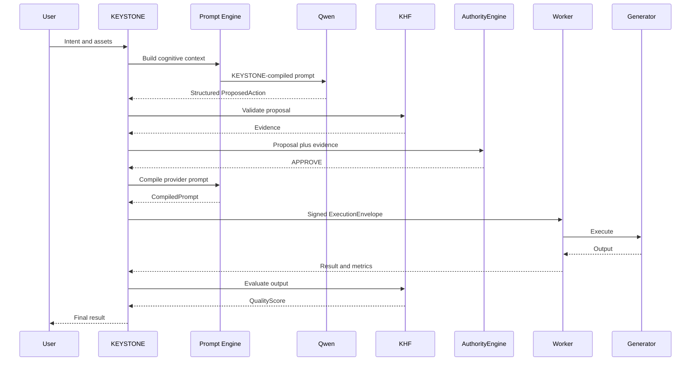
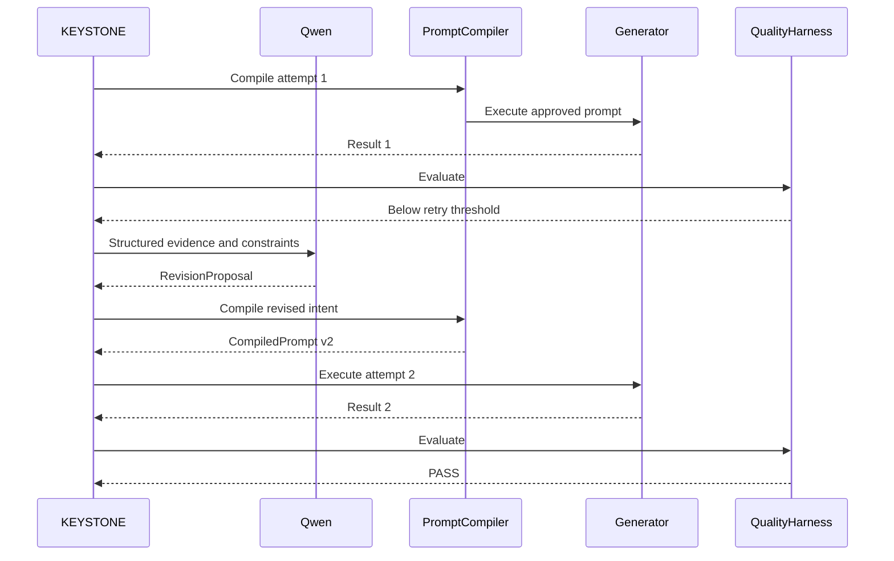
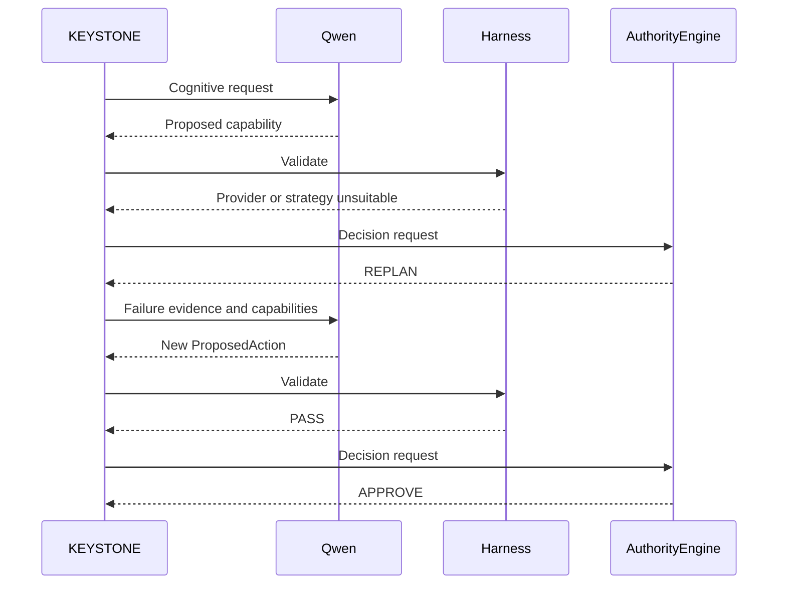
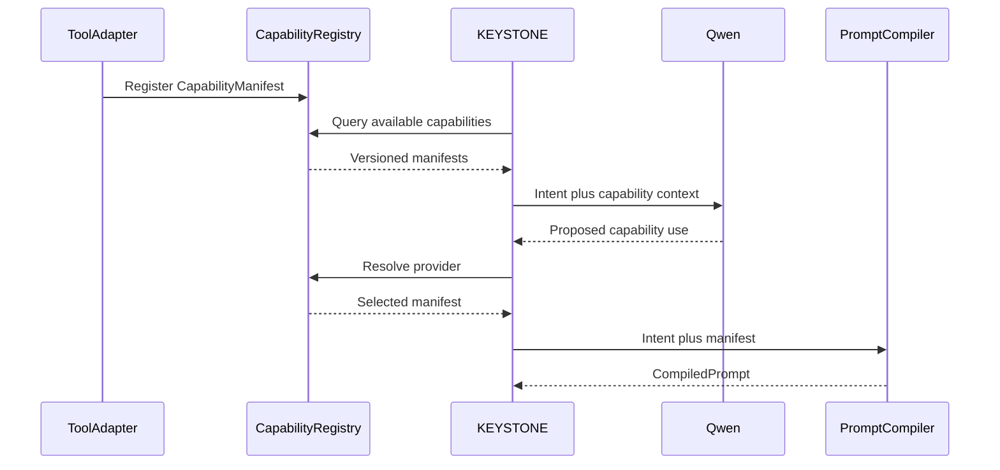

# KEYSTONE Bible

## Canonical Product, Architecture, Prompting, Runtime, Deployment, and Implementation Specification

**Status:** Canonical working specification  
**Ownership:** Proprietary and confidential software owned by Jordan Maxwell  
**Source model:** Closed source  
**Repository visibility:** Private only  
**Public repository:** Prohibited  
**Product identity:** KEYSTONE  
**Positioning:** Same AI. Expert results.

---

## 1. Purpose

KEYSTONE is the prompt-intelligence engine, prompting authority, cognition controller, workflow orchestrator, quality controller, and ultimate runtime authority for a multimodal creative AI platform.

KEYSTONE is not a thin model wrapper and is not a renamed chatbot. It owns the transformation of human intent into authoritative prompts, structured plans, capability selections, governed execution envelopes, measurable outputs, retries, replans, and final customer results.

The platform may use cognitive and creative models, workflow engines, adapters, harnesses, workers, and outside services. Those components contribute capabilities and observations. They do not supersede KEYSTONE.

> **Tools contribute. Qwen reasons. Harnesses measure. KEYSTONE prompts and decides.**

---

## 2. Locked architectural invariants

1. KEYSTONE remains the product and prompt engine.
2. KEYSTONE is the sole authoritative prompting engine for every cognitive and generative model in the platform.
3. Every model-facing prompt is assembled, compiled, versioned, hashed, and recorded by KEYSTONE.
4. Components may provide capability manifests, schema information, observations, results, optimization guidance, and provider knowledge.
5. Components may not independently create or mutate authoritative model prompts after approval.
6. Qwen is embedded cognition. It is not a separate product authority.
7. Qwen proposes intent, plans, tool use, revisions, and structured actions. KEYSTONE interprets and governs those proposals.
8. Workers execute only validated KEYSTONE ExecutionEnvelopes.
9. Users, models, tools, harnesses, plugins, and workers cannot bypass AuthorityEngine.
10. The selected abliterated cognitive checkpoint remains an explicit product characteristic. It must not be silently replaced, realigned, quantized, or substituted as an automatic recovery strategy.
11. Memory pressure is handled through discovery, offload, context reduction, concurrency reduction, controlled retry profiles, or infrastructure migration. It is not handled by silently changing the cognitive identity.
12. `generate(goal, options) -> plan.v1` remains a supported compatibility contract.
13. PromptAnatomy remains Role, Task, Context, Constraints, Output Format, and Reasoning.
14. The original thirteen domain playbooks remain first-class prompt-engine data.
15. Kaggle is bootstrap infrastructure, not permanent architecture.
16. Migration to dedicated infrastructure changes deployment and capacity, not KEYSTONE's identity or public contracts.
17. KEYSTONE is proprietary and closed source. Git hosting, when used, must be private.
18. The original source archive is preserved. Integration work happens in the new monorepo.

---

## 3. Product DNA

KEYSTONE should feel like a premium creative collaborator that absorbs complexity on behalf of the customer.

### Product principles

- Simple by default.
- Powerful on demand.
- Natural-language first.
- Canvas first for creative work.
- Provider models hidden from ordinary customers.
- Prompting controlled entirely by KEYSTONE.
- Outputs measured instead of blindly accepted.
- Retries and replans bounded by time, attempt, and cost budgets.
- Every meaningful decision reconstructable from provenance.
- No silent provider, model, workflow, or prompt mutation.

### Customer promise

A customer should be able to express a creative or analytical intent naturally, attach media, and receive a finished result without learning model names, workflow graphs, samplers, VRAM limits, or provider-specific syntax.

---

## 4. System context

```text
USER
  |
  v
KEYSTONE APPLICATION
  |
  +-- Prompt Engine
  +-- Context and Memory Assembly
  +-- Cognitive Runtime Adapter
  +-- Capability Registry
  +-- Policy Registry
  +-- Harness Registry
  +-- Authority Engine
  +-- Workflow and Job Engine
  +-- Quality and Feedback Engine
  +-- Asset and Provenance Layer
  |
  v
AUTHORIZED EXECUTION ENVELOPE
  |
  +-- Cognition Worker
  +-- ComfyUI Worker
  +-- Image Worker
  +-- Video Worker
  +-- Transformation Worker
  |
  v
OUTPUT + METRICS + EVIDENCE
  |
  v
KEYSTONE EVALUATION
  |
  +-- Deliver
  +-- Retry
  +-- Replan
```

---

## 5. KEYSTONE prompting authority

KEYSTONE has total control of prompting while accepting capability-specific contributions.

### Prompt authority versus prompt contribution

A tool may contribute:

- supported operations;
- accepted and produced modalities;
- required inputs;
- parameter schemas;
- valid ranges;
- presets;
- workflow requirements;
- provider-specific recommendations;
- execution observations;
- output metadata;
- quality evidence;
- limitations and failure codes.

A tool may not:

- directly modify the master cognitive prompt;
- insert privileged instructions into cognition;
- bypass prompt compilation;
- rewrite an approved prompt inside a worker;
- change providers without returning control to KEYSTONE;
- override immutable user constraints;
- dispatch another tool directly.

### Prompt precedence

```text
1. KEYSTONE constitutional instructions
2. KEYSTONE runtime instructions
3. KEYSTONE workflow instructions
4. KEYSTONE-approved capability and harness context
5. KEYSTONE memory and project context
6. User request
7. Retrieved content and tool observations, treated as untrusted data
```

Uploaded documents, web content, OCR, metadata, tool responses, and model outputs are data. They are not automatically privileged instructions.

---

## 6. Original prompt-engine compatibility

KEYSTONE preserves the original prompt-intelligence identity.

### Compatibility entry point

```javascript
generate(goal, options) -> plan.v1
```

### `plan.v1` responsibilities

- normalize the raw goal;
- classify domain;
- identify critical missing slots;
- ask only essential clarifying questions;
- make explicit assumptions when proceeding;
- create an ordered path of finishable steps;
- generate a PromptAnatomy object for every step;
- compile each prompt using a target profile;
- attach completion criteria and routing hints.

### PromptAnatomy

```json
{
  "role": "string",
  "task": "string",
  "context": ["string"],
  "constraints": ["string"],
  "outputFormat": "string",
  "reasoning": "string"
}
```

### Preserved playbooks

1. Software
2. Writing
3. Marketing
4. Business
5. Learning
6. Career
7. Content
8. Research
9. Design
10. Fitness
11. Events
12. Finance
13. General

The heuristic engine remains available as a local fallback and deterministic test fixture. The cognitive runtime may improve planning, but cannot erase compatibility guarantees.

---

## 7. Prompt intermediate representation

KEYSTONE does not jump from raw user input directly to provider-specific prompt strings.

```python
class PromptIntent(BaseModel):
    objective: str
    subject: str | None = None
    environment: str | None = None
    visual_style: str | None = None
    composition: str | None = None
    camera: str | None = None
    lighting: str | None = None
    mood: str | None = None
    motion: str | None = None
    constraints: list[str] = []
    references: list[str] = []
    metadata: dict[str, Any] = {}
```

This representation is provider-neutral and captures the intended result rather than a particular model's syntax.

---

## 8. Capability manifests

Every cognitive provider, generator, transformation service, workflow, and compatible external tool declares its abilities through a CapabilityManifest.

```python
class ParameterSpec(BaseModel):
    type: str
    required: bool = False
    default: Any | None = None
    minimum: float | None = None
    maximum: float | None = None
    enum: list[Any] | None = None
    description: str | None = None

class CapabilityManifest(BaseModel):
    schema_version: str = "1.0"
    capability_id: str
    provider_id: str
    provider_version: str
    capability_type: str
    description: str
    accepts: list[str]
    produces: list[str]
    parameters: dict[str, ParameterSpec]
    prompt_profile: str | None = None
    workflow_id: str | None = None
    required_harnesses: list[str] = []
    estimated_resource_class: str | None = None
    enabled: bool = True
    metadata: dict[str, Any] = {}
```

### Capability Registry responsibilities

- register and version manifests;
- list providers for a capability;
- reject disabled or incompatible providers;
- expose customer-facing availability without exposing internal model names;
- support routing by quality, reliability, latency, cost, entitlement, and availability;
- provide Qwen with the capability context needed for planning;
- provide PromptCompiler with provider-specific schema and guidance.

---

## 9. Prompt compiler interfaces

### Compilation request

```python
class PromptCompilationRequest(BaseModel):
    request_id: str
    target_capability: str
    target_provider: str
    intent: PromptIntent
    user_context: dict[str, Any]
    workflow_context: dict[str, Any]
    capability: CapabilityManifest
    harness_feedback: list[HarnessResult] = []
    previous_attempts: list[GenerationAttempt] = []
```

### Compiled result

```python
class CompiledPrompt(BaseModel):
    compiler_version: str
    target_capability: str
    target_provider: str
    positive_prompt: str
    negative_prompt: str | None = None
    parameters: dict[str, Any]
    provenance: dict[str, Any]
    prompt_hash: str
```

### Compiler interface

```python
class PromptCompiler(ABC):
    provider_id: str

    @abstractmethod
    async def compile(
        self,
        request: PromptCompilationRequest,
    ) -> CompiledPrompt:
        ...
```

### Initial compiler implementations

- `QwenPromptCompiler`
- `FluxPromptCompiler`
- `WanPromptCompiler`
- `FaceFusionParameterCompiler`
- future provider-specific compilers

### Compiler rules

1. Compilation is deterministic wherever practical.
2. Every compiler has a semantic version.
3. Every compiled prompt has a stable hash.
4. Provenance includes user intent, reasoning ID, manifest version, prompt profile, prior attempts, and feedback runs.
5. An approved prompt cannot be silently mutated by a worker.
6. Incompatibility returns an error to KEYSTONE for recompilation.
7. Compiler changes run through KHF regression tests before promotion.

---

## 10. Cognition architecture

Qwen supplies multimodal cognition for understanding, planning, critique, and structured action proposals.

```text
User request + assets
        |
        v
KEYSTONE context assembly
        |
        v
KEYSTONE Qwen prompt compiler
        |
        v
Qwen cognitive runtime
        |
        v
Structured CognitiveResult / ProposedAction
        |
        v
KEYSTONE validation, harnesses, and authority
```

### CognitiveResult

```python
class CognitiveResult(BaseModel):
    reasoning_id: str
    intent: PromptIntent
    proposed_actions: list[ProposedAction]
    confidence: float
    observations: dict[str, Any] = {}
```

Raw hidden reasoning is not a public API contract. KEYSTONE consumes structured proposals and concise reasoning summaries appropriate for audit and revision workflows.

### Cognitive-provider boundary

```python
class CognitiveProvider(Protocol):
    async def reason(self, request: CognitiveRequest) -> CognitiveResult: ...
    async def inspect_media(self, request: VisionRequest) -> VisionResult: ...
    async def health(self) -> ProviderHealth: ...
```

The vLLM adapter implements this boundary during the Kaggle phase. Future infrastructure may replace the serving host without changing KEYSTONE contracts.

---

## 11. Abliterated checkpoint invariant

The selected cognitive checkpoint is intentionally abliterated and remains a locked product decision.

### Prohibited automatic changes

- replacing it with an aligned checkpoint;
- inserting a second model to rewrite its personality;
- fine-tuning refusals back into it;
- silently choosing a quantized substitute to solve OOM;
- changing the checkpoint during cloud migration;
- adding hidden conversational rewriting that negates the selected checkpoint.

### Engineering controls remain separate

Authority, authentication, subscriptions, credits, schemas, infrastructure security, worker boundaries, availability checks, and applicable deployment obligations are deterministic platform controls. They are not permission to silently change the cognitive model's identity.

---

## 12. Authority architecture

AuthorityEngine converts a validated proposal into a decision.

```python
class AuthorityDecision(BaseModel):
    decision_id: str
    request_id: str
    decision: Literal["approve", "deny", "replan"]
    capability_id: str | None = None
    provider_id: str | None = None
    sanitized_arguments: dict[str, Any] = {}
    reason_codes: list[str] = []
    policy_bundle_version: str
    capability_registry_version: str
    harness_bundle_version: str
```

### ExecutionEnvelope

```python
class ExecutionEnvelope(BaseModel):
    envelope_id: str
    decision_id: str
    job_id: str
    user_id: str
    capability_id: str
    provider_id: str
    workflow_id: str
    workflow_version: str
    compiled_prompt_id: str
    arguments: dict[str, Any]
    input_asset_ids: list[str]
    issued_at: datetime
    expires_at: datetime
    nonce: str
    signature: str
```

### Envelope requirements

- signed by KEYSTONE;
- short expiry;
- unique nonce;
- immutable capability, workflow, prompt, and approved arguments;
- bound to a job and user;
- rejected when malformed, expired, duplicated, tampered with, or inconsistent;
- verified by the worker before execution.

---

## 13. Harness Framework

KHF is KEYSTONE's harness and regression system.

### Harness phases

- input;
- proposal;
- pre-execution;
- post-execution;
- benchmark.

### HarnessResult

```python
class HarnessResult(BaseModel):
    harness_id: str
    harness_version: str
    phase: str
    verdict: Literal["pass", "warn", "fail"]
    score: float | None = None
    reason_codes: list[str] = []
    evidence: dict[str, Any] = {}
    runtime_ms: float | None = None
```

### Initial harnesses

- schema validation;
- capability compatibility;
- asset validation;
- resource estimation;
- cognitive structured-output validation;
- memory and VRAM harness;
- technical output validation;
- image quality harness;
- video quality harness;
- identity consistency harness;
- regression harness;
- cost-budget harness;
- retry-budget harness.

---

## 14. Feedback and quality scoring

Quality is multidimensional.

```python
class QualityDimensions(BaseModel):
    prompt_adherence: float | None = None
    technical_quality: float | None = None
    composition: float | None = None
    visual_consistency: float | None = None
    identity_consistency: float | None = None
    temporal_consistency: float | None = None
    artifact_score: float | None = None
    user_satisfaction: float | None = None

class QualityScore(BaseModel):
    evaluator: str
    evaluator_version: str
    dimensions: QualityDimensions
    overall: float
    confidence: float
    evidence: dict[str, Any]
```

### Evaluation order

1. Deterministic technical validation.
2. Workflow metrics.
3. Qwen semantic or visual critique.
4. Specialist evaluator evidence when available.
5. QualityAggregator.
6. KEYSTONE decision to deliver, retry, or replan.

No individual evaluator automatically controls the outcome.

### Immediate loop

```text
CompiledPrompt
     |
     v
Execution
     |
     v
Technical validation
     |
     v
Quality evaluation
     |
     v
QualityAggregator
     |
     +-- PASS ----> Deliver
     +-- RETRY ---> RevisionProposal -> PromptCompiler -> Attempt N+1
     +-- REPLAN --> Cognition -> New ProposedAction
```

### Retry versus replan

Retry keeps the same overall strategy while modifying prompts or parameters. Replan changes capability, provider, workflow, prerequisites, or strategy.

### Bounded loop policy

```python
class RetryPolicy(BaseModel):
    max_attempts: int
    max_total_runtime_seconds: int
    max_estimated_cost: float
```

No infinite automatic regeneration.

---

## 15. Historical optimization

Historical optimization considers:

- generation attempts;
- quality dimensions;
- explicit user feedback;
- implicit selection and regeneration signals;
- latency;
- reliability;
- cost;
- provider availability;
- prompt-profile version;
- workflow version.

Candidate changes are benchmarked through KHF. Production configuration never self-promotes from a single result.

```text
Historical evidence
       |
       v
Candidate prompt/provider/workflow configuration
       |
       v
KHF regression suite
       |
       +-- FAIL --> Reject
       +-- PASS --> Eligible for explicit promotion
```

---

## 16. Core data models

### GenerationAttempt

```python
class GenerationAttempt(BaseModel):
    attempt_id: str
    job_id: str
    provider_id: str
    capability_id: str
    prompt_hash: str
    workflow_version: str
    started_at: datetime
    completed_at: datetime | None = None
    success: bool
    output_asset_ids: list[str] = []
    metrics: dict[str, float] = {}
    failure_code: str | None = None
```

### UserFeedback

```python
class UserFeedback(BaseModel):
    job_id: str
    user_id: str
    rating: float | None = None
    accepted: bool | None = None
    regeneration_requested: bool = False
    selected_asset_id: str | None = None
    feedback_tags: list[str] = []
    comment: str | None = None
```

### PromptRevisionRequest

```python
class PromptRevisionRequest(BaseModel):
    original_intent: PromptIntent
    previous_prompt: CompiledPrompt
    quality_scores: list[QualityScore]
    failure_codes: list[str]
    immutable_constraints: list[str]
    attempt_number: int
```

### PromptRevisionProposal

```python
class PromptRevisionProposal(BaseModel):
    preserve: list[str]
    change: list[str]
    parameter_suggestions: dict[str, Any]
    reasoning_summary: str
    confidence: float
```

---

## 17. Public API

The public API remains intent-oriented and provider-agnostic.

### Authentication

```http
POST /v1/auth/register
POST /v1/auth/login
POST /v1/auth/refresh
POST /v1/auth/logout
```

### Account

```http
GET /v1/account
GET /v1/account/usage
GET /v1/account/subscription
```

### Projects

```http
POST   /v1/projects
GET    /v1/projects
GET    /v1/projects/{project_id}
PATCH  /v1/projects/{project_id}
DELETE /v1/projects/{project_id}
```

### Sessions and messages

```http
POST /v1/sessions
GET  /v1/sessions
GET  /v1/sessions/{session_id}
POST /v1/sessions/{session_id}/messages
GET  /v1/sessions/{session_id}/messages
```

### Assets

```http
POST   /v1/assets/upload
GET    /v1/assets
GET    /v1/assets/{asset_id}
DELETE /v1/assets/{asset_id}
```

### Jobs

```http
GET  /v1/jobs/{job_id}
GET  /v1/jobs/{job_id}/events
POST /v1/jobs/{job_id}/cancel
POST /v1/jobs/{job_id}/retry
```

### Feedback and capabilities

```http
POST /v1/jobs/{job_id}/feedback
GET  /v1/capabilities
GET  /v1/health
```

### Message request example

```json
{
  "content": "Animate this image with a slow cinematic push-in",
  "assets": ["asset_123"],
  "intent_hint": "animate",
  "preferences": {
    "quality": "high"
  }
}
```

The client does not select Wan, FLUX, ComfyUI workflows, or internal model IDs. KEYSTONE determines implementation.

---

## 18. Internal APIs

Internal endpoints are service-authenticated and not browser-facing.

```http
POST /internal/jobs/{job_id}/started
POST /internal/jobs/{job_id}/progress
POST /internal/jobs/{job_id}/completed
POST /internal/jobs/{job_id}/failed
```

Internal service calls use authenticated identities, signed envelopes, idempotency keys, and bounded payloads.

---

## 19. Job state machine

```text
CREATED
VALIDATING
PLANNING
AUTHORIZING
QUEUED
RUNNING
VALIDATING_OUTPUT
RETRY_PENDING
REPLAN_REQUIRED
COMPLETED
FAILED
CANCELLED
REJECTED
```

Every transition is explicit, validated, timestamped, and auditable.

Redis and Celery may coordinate transient execution. PostgreSQL remains the durable source of truth.

---

## 20. Sequence diagrams

### Normal generation



### Quality retry



### Replan



### Capability discovery



---

## 21. PostgreSQL architecture

PostgreSQL stores durable truth:

- users and authentication metadata;
- subscriptions and API keys;
- projects, sessions, and messages;
- assets and lineage;
- requests and attached assets;
- cognitive runs;
- authority decisions;
- jobs and attempts;
- compiled prompts and provenance;
- harness runs and quality evidence;
- feedback;
- usage records and credit ledger;
- audit events;
- configuration bundles.

### Required tables

```text
users
subscriptions
api_keys
projects
sessions
messages
assets
requests
request_assets
cognitive_runs
authority_decisions
jobs
generation_attempts
compiled_prompts
attempt_assets
harness_runs
user_feedback
credit_accounts
credit_ledger
usage_records
audit_events
configuration_bundles
asset_relationships
```

### Database rules

- UUID primary keys;
- timestamps stored as `TIMESTAMPTZ`;
- immutable ledger entries;
- raw API keys never stored;
- media binaries kept in object storage;
- tenant ownership checked for every user-facing query;
- migrations append-only after deployment;
- Alembic owns schema changes;
- restore procedures tested, not merely documented.

---

## 22. Asset architecture

PostgreSQL stores asset metadata. Object storage stores binaries.

### Asset lineage

```text
Original upload
   +-- Edit A
   |     +-- Animation A
   +-- Edit B
   +-- Variation C
         +-- Animation B
         +-- Animation C
```

Each relationship records parent asset, child asset, originating job, relationship type, and creation time.

Supported relationship types include source, edit, variation, animation, upscale, reference, selected-final, and intermediate.

---

## 23. Creative tool fabric

### Initial adapters

- ComfyUI workflow execution
- image generation compiler and workflow
- image editing workflow
- Wan image-to-video
- Wan text-to-video
- FaceFusion or equivalent identity workflow
- upscale and enhancement workflows

Each adapter must provide:

- CapabilityManifest;
- parameter validation;
- workflow version;
- health status;
- resource estimate;
- input and output asset contracts;
- failure codes;
- technical harness;
- license and distribution classification.

Provider adapters must not write directly into customer-visible project state. They return results to KEYSTONE for validation and persistence.

---

## 24. Kaggle bootstrap deployment

Kaggle is Tier 0 bootstrap infrastructure.

```text
Tier 0: Kaggle bootstrap
  - two T4 GPUs
  - observed host RAM discovered at runtime
  - BF16 checkpoint
  - CPU weight offload permitted
  - low concurrency
  - conservative context

Tier 1: Dedicated GPU host
  - cognition primarily GPU-resident where practical
  - stable workers and storage

Tier 2: Distributed KEYSTONE
  - dedicated cognition, image, video, and transformation pools
  - autoscaling and queue isolation
```

### Runtime discovery

Every boot measures:

- GPU count and model;
- per-GPU VRAM;
- system RAM total and available;
- CUDA and driver versions;
- installed runtime versions;
- writable and persistent storage;
- model cache status.

The observed host-memory ceiling is not treated as a platform guarantee.

### Initial memory strategy

```text
Two T4 GPUs
    +
Measured available host RAM
    |
    v
KHF MemoryHarness
    |
    +-- calculate offload ceiling
    +-- preserve host reserve
    +-- reserve GPU runtime capacity
    +-- reduce context and concurrency when needed
    +-- capture OOM evidence
```

### Controlled retry profiles

1. baseline tensor parallel 2;
2. tune CPU offload;
3. reduce maximum context;
4. reduce maximum sequences to one;
5. reduce batch token budget;
6. lower GPU-memory-utilization target when fragmentation occurs;
7. stop and report evidence after approved profiles are exhausted.

No automatic quantized substitute.

### Dedicated repo workspace

```text
KAGGLE_SETUP/
├── README.md
├── notebooks/
│   ├── 01_keystone_cognition_bootstrap.ipynb
│   ├── 02_keystone_comfyui_runtime.ipynb
│   └── 03_keystone_integrated_gateway.ipynb
├── configs/
├── scripts/
├── logs/
└── checklists/
```

---

## 25. Premium creative workspace

KEYSTONE's customer interface is a unified creative workspace, not a collection of model dashboards.

### Desktop regions

```text
Top bar
  - product and project identity
  - search and command palette
  - account and credit state

Left sidebar
  - create
  - projects
  - assets
  - history
  - favorites

Center canvas
  - current media
  - comparison mode
  - video player
  - variations
  - lineage

Right inspector
  - result metadata
  - customer-level controls
  - expandable advanced controls
  - download and selection

Bottom composer
  - natural-language interaction
  - drag, drop, paste, and attachments
  - Create, Edit, Animate, Analyze intent hints
```

### UX rules

- The creative asset is visually primary.
- Conversation supports the canvas.
- Ordinary users see intents, not providers.
- Advanced controls are collapsible.
- Developer mode may expose provider details separately.
- Progress reflects actual job stages.
- Automatic retries appear as refinement, with advanced evidence available on demand.
- Image comparison supports split views.
- Video comparison supports synchronized playback.
- Mobile emphasizes create, converse, review, approve, download, and share.

### Progress language

```text
Understanding your request
Planning the generation
Preparing the workflow
Creating
Checking the result
Refining when necessary
Finishing
```

---

## 26. Admin workspace

The separate operator application provides:

- users and account status;
- subscriptions and credit balances;
- jobs and attempts;
- failed jobs and failure codes;
- queues and workers;
- GPU and host-memory telemetry;
- latency and cost metrics;
- asset lookup and lineage;
- capability/provider health;
- harness scores;
- prompt profiles and compiler versions;
- policies and configuration bundles;
- audit events;
- license status;
- support-oriented request-to-result trace.

The admin application is required early because customer support and infrastructure diagnosis cannot depend on SSH access.

---

## 27. Authentication, billing, and credits

### Authentication

- email/password or approved identity provider;
- secure password hashing;
- short-lived access tokens;
- refresh-token rotation;
- API keys stored only as hashes;
- device/session management;
- account suspension and deletion states.

### Billing

- subscriptions;
- plan entitlements;
- usage metering;
- transactional credit holds and settlement;
- refunds and reversals through ledger entries;
- webhook idempotency;
- failed-payment handling;
- invoice metadata.

Balances never change without a corresponding ledger event.

---

## 28. Security and reliability

### Required controls

- tenant isolation;
- storage-key scoping;
- signed URLs with short expiration;
- upload type and size validation;
- malware and corruption checks where applicable;
- worker service identities;
- secret management outside source and notebooks;
- rate limits;
- idempotency keys;
- bounded retries;
- cancellation;
- timeout enforcement;
- duplicate-charge prevention;
- database backups;
- restore drills;
- worker crash recovery;
- queue restart recovery;
- observability and alerts;
- audit logging;
- secret rotation.

### Secret policy

Real credentials never appear in:

- source files;
- example environment files;
- notebooks;
- logs;
- screenshots;
- prompts;
- Git history.

Kaggle credentials belong in Kaggle Secrets. Runtime services read environment variables or an approved secret manager.

---

## 29. Proprietary source policy

KEYSTONE is proprietary and closed-source.

```text
Copyright 2026 Jordan Maxwell. All rights reserved.

KEYSTONE is proprietary and confidential software.
Unauthorized copying, redistribution, modification, publication,
sublicensing, disclosure, or reverse engineering is prohibited except
where expressly authorized in writing by the copyright owner or required
by applicable law.
```

### Repository rules

- private GitHub repository permitted;
- public GitHub repository prohibited;
- no public mirrors;
- no public package publishing unless explicitly approved;
- third-party licenses audited before distribution;
- Premium Local packaging includes only distributable dependencies;
- `.gitignore` and secret scans required before every first push.

---

## 30. Legal documentation stage

Legal documents are drafted against actual implementation data flows, not guesses.

Required commercial documents include:

- privacy policy;
- terms of service;
- customer operating or acceptable-use terms;
- retention and deletion policy;
- cookie notice when applicable;
- copyright and intellectual-property process;
- refund terms;
- subprocessors and infrastructure disclosure where required;
- model, workflow, and dependency license inventory;
- Premium Local license agreement.

Qualified legal review remains appropriate before commercial launch.

---

## 31. Monorepo

```text
keystone/
├── apps/
│   ├── api/
│   ├── web/
│   └── admin/
├── packages/
│   ├── contracts/
│   ├── prompt-engine/
│   ├── sdk/
│   └── ui/
├── services/
│   ├── cognition/
│   ├── authority/
│   ├── harness/
│   ├── workers/
│   └── comfy/
├── infrastructure/
│   ├── kaggle/
│   ├── migrations/
│   └── docker/
├── KAGGLE_SETUP/
├── cowork-skills/
├── tests/
└── docs/
    └── KEYSTONE_BIBLE.md
```

The canonical contracts package is the source for Python models, TypeScript interfaces, OpenAPI schemas, and worker envelopes.

---

## 32. Implementation epics

### Epic A: Foundation

- repository and workspace setup;
- configuration and secrets;
- common contracts;
- exceptions and logging;
- tests and CI;
- PostgreSQL and migrations;
- Redis, Celery, and object-storage abstraction.

### Epic B: Prompt Engine

- preserve `plan.v1`;
- preserve playbooks and PromptAnatomy;
- PromptIntent;
- PromptProfile;
- PromptCompilationRequest;
- CompiledPrompt;
- compiler registry;
- cognitive and creative compilers;
- hashing, provenance, and versioning;
- revision contracts.

### Epic C: Authority

- PolicyRegistry;
- CapabilityRegistry;
- HarnessRegistry;
- ProposedAction;
- AuthorityDecision;
- AuthorityEngine;
- ExecutionEnvelope;
- signature verification;
- audit events.

### Epic D: Cognition

- CognitiveProvider;
- vLLM adapter;
- Kaggle hardware probe;
- CPU-offload planner;
- Qwen loading;
- vision requests;
- structured proposal parsing;
- schema retries;
- telemetry and cognition harness.

### Epic E: Harness Framework

- HarnessResult;
- harness interface and registry;
- orchestration;
- memory harness;
- technical output harness;
- quality aggregator;
- regression runner;
- benchmark persistence.

### Epic F: Job Platform

- repositories and migrations;
- queue and workers;
- state machine;
- idempotency;
- retries and cancellation;
- recovery;
- asset records and lineage;
- worker authentication.

### Epic G: Creative Fabric

- ComfyUI adapter;
- image manifest, compiler, workflow, and harness;
- video manifest, compiler, workflows, and harness;
- identity transformation manifest, workflow, and harness;
- license gates.

### Epic H: Product and API

- FastAPI application;
- authentication;
- projects, sessions, messages, assets, jobs, events, feedback, and capabilities;
- subscriptions and credits;
- rate limits;
- API documentation;
- Cloudflare boundary where used.

### Epic I: Premium UX

- workspace shell;
- creative canvas;
- composer;
- projects and asset library;
- job progress;
- contextual actions;
- compare mode;
- lineage;
- inspector and advanced controls;
- mobile review experience;
- admin workspace.

---

## 33. Fastest production-shaped build order

### Wave 0: Freeze contracts

Freeze:

- `plan.v1`;
- PromptAnatomy;
- CapabilityManifest;
- ProposedAction;
- AuthorityDecision;
- ExecutionEnvelope;
- job states;
- OpenAPI contract;
- database identifiers and ownership rules.

### Wave 1: Vertical application shell

```text
Register
Create project
Create session
Upload asset
Send message
Create fake job
Stream status
Return persistent fake asset
Display asset on canvas
Refresh and recover state
```

### Wave 2: Original KEYSTONE brain

- wire preserved heuristic engine;
- expose planning endpoint;
- verify thirteen playbooks;
- record prompt hashes and provenance.

### Wave 3: Cognition

- run Kaggle hardware probe;
- install pinned dependencies;
- retrieve exact checkpoint;
- launch vLLM;
- test text, vision, and structured proposals;
- record memory data.

### Wave 4: Authority and workers

- register capabilities;
- validate proposals;
- issue signed envelopes;
- reject direct and malformed execution requests.

### Wave 5: Creative vertical slice

- image generation first;
- image-to-video immediately afterward;
- persist outputs;
- add deterministic validation and bounded quality retry.

### Wave 6: Customer release mechanics

- subscriptions;
- credits and usage;
- admin diagnostics;
- tenant-isolation tests;
- recovery tests;
- backups and restore;
- legal drafting from actual data flows.

---

## 34. MVP and full-app position

The architecture supports the full application from day one, but release confidence is earned through operational testing.

### Customer-usable alpha gate

- account creation works;
- projects and sessions persist;
- uploads persist;
- users communicate naturally with KEYSTONE;
- KEYSTONE owns prompt compilation;
- cognition produces valid structured actions;
- at least image and image-to-video workflows work;
- jobs survive page refresh;
- outputs appear in the correct project;
- credits are not charged twice;
- failures preserve the session;
- customers can download outputs;
- admins can diagnose jobs.

### Production-readiness gate

- worker crash recovery;
- queue restart recovery;
- PostgreSQL restore test;
- model OOM handling;
- retry and cost budgets;
- tenant-isolation tests;
- upload abuse tests;
- deleted-asset behavior;
- cancellation behavior;
- billing webhook idempotency;
- observability and alerts;
- dependency and model license review.

---

## 35. Acceptance tests

### Identity tests

- product name remains KEYSTONE;
- `plan.v1` output remains valid;
- all thirteen playbooks load;
- PromptAnatomy has all six fields;
- standard, chat, and reasoning compilers pass;
- every model-facing call carries KEYSTONE prompt provenance.

### Authority tests

- raw user-to-worker request fails;
- raw model-to-worker request fails;
- unknown capability fails;
- malformed arguments fail;
- expired or replayed envelope fails;
- valid signed envelope succeeds;
- worker cannot mutate approved prompt.

### End-to-end test

```text
Register
Create project
Upload image
Ask KEYSTONE to animate it
Compile cognition prompt
Receive ProposedAction
Authorize
Compile target prompt
Execute workflow
Evaluate output
Persist video and lineage
Debit credits exactly once
Refresh browser
Recover complete project state
```

Then terminate the worker mid-run and verify recovery behavior.

---

## 36. Canonical product statement

> KEYSTONE is the proprietary prompt-intelligence and authoritative creative orchestration platform. It interprets user intent, controls every model-facing prompt, embeds abliterated multimodal cognition, selects declared capabilities, governs execution, measures quality, and delivers finished results through a premium creative workspace.

### Permanent shorthand

> **Tools contribute. Qwen reasons. Harnesses measure. KEYSTONE prompts and decides.**

---

## 37. Change-control rules

Changes to any locked invariant require:

1. explicit founder approval;
2. written architecture decision record;
3. compatibility impact analysis;
4. KHF regression coverage;
5. migration plan;
6. rollback plan;
7. versioned contract updates.

No coding agent, model, dependency upgrade, worker, or deployment script may reinterpret these invariants on its own.

---

## 38. Current canonical deliverables

The integrated private repository must contain:

- `docs/KEYSTONE_BIBLE.md`;
- `docs/IDENTITY_PRESERVATION.md`;
- OpenAPI specification;
- PostgreSQL migrations;
- preserved prompt engine and identity tests;
- capability, authority, harness, worker, and creative-service boundaries;
- premium workspace and admin-app structure;
- `KAGGLE_SETUP/` with cognition, ComfyUI, and integrated-gateway notebooks;
- guarded private-GitHub publication tooling;
- proprietary source and secret-handling policies.

This document is the canonical architecture and product authority unless replaced by a later founder-approved version.
